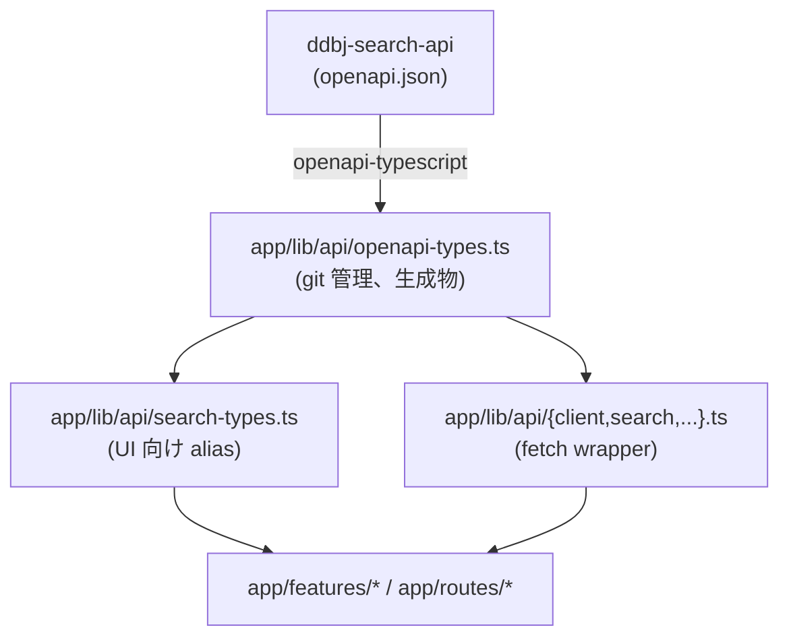
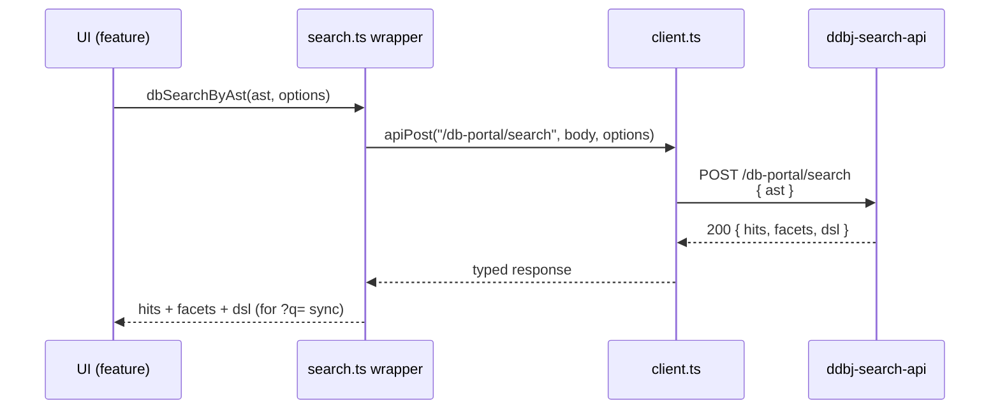
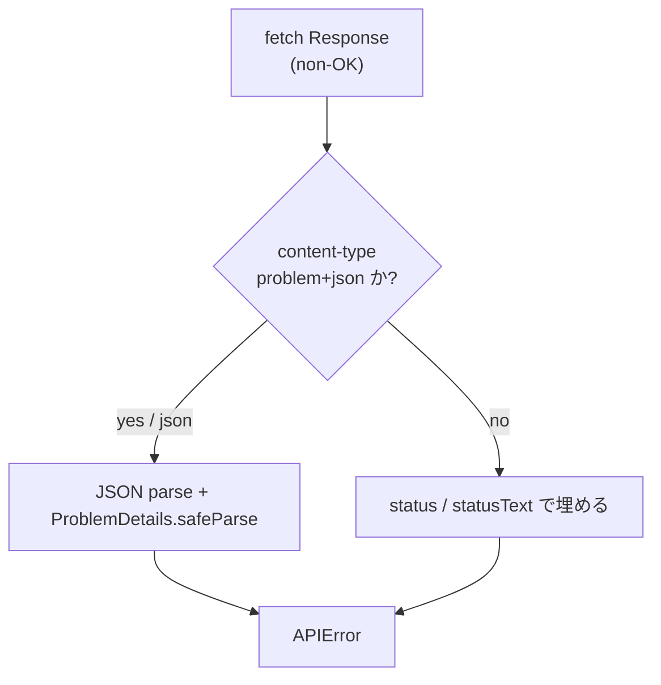

# API Types

ddbj-search-api (検索 backend) との型の連携。BSI は backend が公開する OpenAPI 仕様を正として型を生成し、生成した型の 1 系統だけを UI 層まで使う。型生成、UI 向け alias、fetch wrapper、エラーの正規化、開発者が手元で生成して git diff で確認する運用を扱う。

## consume する endpoint

BSI は ddbj-search-api を呼び出すだけで、検索の AST / DSL の grammar は backend 側が定義する ([search.md](search.md))。BSI が呼び出す endpoint は次の 4 つだけである。各 endpoint の method と request / response の形は、生成物の `app/lib/api/openapi-types.ts` を SSOT とする。

| Path | 用途 |
|---|---|
| `/db-portal/cross-search` | cross-DB 検索 (DSL `q` または AST body) |
| `/db-portal/search` | per-DB 検索 (DSL `q` または AST body) |
| `/db-portal/parse` | DSL → AST |
| `/db-portal/serialize` | AST → DSL |

backend の型を BSI 側で扱う流れは次のとおりである。



生成物は `lib` zone に属し、import の方向は [architecture.md](architecture.md) § Zone 分割 の規約に従う。BSI 側には、手書きの AST / DSL 型と自前の serializer を置かない。

## 型生成と差分検知

開発者は検索 backend の OpenAPI 仕様から `app/lib/api/openapi-types.ts` を手元で生成し、生成物を git に commit する。CI では自動生成しない。API 仕様の変更に気付かないまま型の不整合で壊れることを避けるため、開発者が diff を読み、生成型を使う wrapper / alias / feature を同じ commit で更新する。

- 生成元の URL は env `DB_PORTAL_OPENAPI_URL` で切り替える
- `docker compose exec app npm run gen:api-types` を実行すると `openapi-typescript` が生成する
- 出力先は `app/lib/api/openapi-types.ts` に固定する
- 生成物を人間が直接編集しない。再生成して差分が出たら、まず API 仕様の変更を疑う

差分の確認には次の 2 つのコマンドを使う。

```bash
docker compose exec app npm run gen:api-types
git diff app/lib/api/openapi-types.ts
```

差分が出たら、生成型を使っている wrapper / alias / feature を同じ commit で更新する。dev と staging の環境は staging の API を共有して使い、型も staging の API から生成する。production のリリース直前にだけ production の API URL で生成し直し、staging から生成したものとの差分を最終確認する (手順は [deployment.md](deployment.md) を参照する)。

生成型 (`paths` / `components`) は wrapper と alias の層からだけ参照する。`app/features/*` と `app/routes/*` から `openapi-types.ts` を直接 import しない。

## UI 向け alias

backend は検索 AST を discriminated union として定義している。`openapi-typescript` はこの union を、Request 用 (`-Input` suffix) と Response 用 (`-Output` suffix) の 2 系統の型に分けて出力する。2 系統の型を UI 層がそのまま使うと import が煩雑になるので、`app/lib/api/search-types.ts` が 2 系統の違いを UI 層から隠す。

- UI 層は Response 系の型を元にした 1 つの alias だけを import する
- Request 系の型への変換は、serialize を呼び出す 1 箇所だけで行う
- ハイフンを含む生成型名 (`...-Output`) を UI 層で使わない
- `op` discriminator で leaf node と `BoolOp` (AND / OR / NOT) を型として区別できる形を保つ

backend 側で alias 名や suffix の規約が変わっても、修正するファイルは `search-types.ts` の 1 つだけである。

## fetch wrapper

`app/lib/api/client.ts` は型付きの fetch wrapper で、`paths` 型から operation ごとの query / requestBody / response の型を推論する。呼び出し側は path 文字列を書かず、`app/lib/api/search.ts` などの thin wrapper 関数を通して呼ぶ。

- base URL は呼び出し側が渡す。wrapper は env を直接参照しない
- 同じ operation の query / body / response が食い違わないことを型で保証する
- wrapper 以外のコードに path 文字列を直接書かない。直接書くと補完と型推論が働かない

検索 endpoint は 1 回の POST で結果、facet、DSL をまとめて返すので、client 側では serialize / parse を追加で呼ばない。GET と POST が同じ結果を返すことと、URL の `?q=` と同期する規則は [search.md](search.md) § API との往復 を SSOT とする。



## エラー正規化

HTTP エラーはすべて `app/lib/api/errors.ts` の `APIError` クラスに変換する。呼び出し側は `APIError` だけを扱えばよく、HTTP status、RFC 7807 の problem+json、単なる text の response の差を意識しなくてよい。

- `errors.ts` は RFC 7807 `application/problem+json` を最優先で解釈する
- problem+json のフィールドが欠けているときは、HTTP status と statusText で補う
- body が JSON でないときは、statusText を message にする
- 呼び出し側は `instanceof` ではなく `isAPIError` type guard で判定する



TanStack Query の retry の規則も `APIError` を前提にする。query は 5xx のときだけ retry し、mutation は retry しない。mutation の再試行は、利用者が操作する UI を別に用意して行う。retry の上限と判定条件は `app/lib/query/client.ts` を SSOT とする。

## 環境変数

env の定義 / 型 / default は `server/lib/env.ts` の Zod schema が SSOT で、値は `env.staging` 等が SSOT である。この文書に関わる env:

- `DB_PORTAL_OPENAPI_URL`: `openapi-typescript` の生成元 URL (build / dev だけで使う)
- `DB_PORTAL_SEARCH_API_URL`: server 側 (SSR / BFF) から呼ぶ検索 API の base URL
- `VITE_DB_PORTAL_SEARCH_API_URL`: client bundle に埋め込む検索 API の base URL。build 時に Vite が値を静的に置換するので、runtime には変更できない

env の規約と、build 時と runtime の境界は [architecture.md](architecture.md) を参照する。
