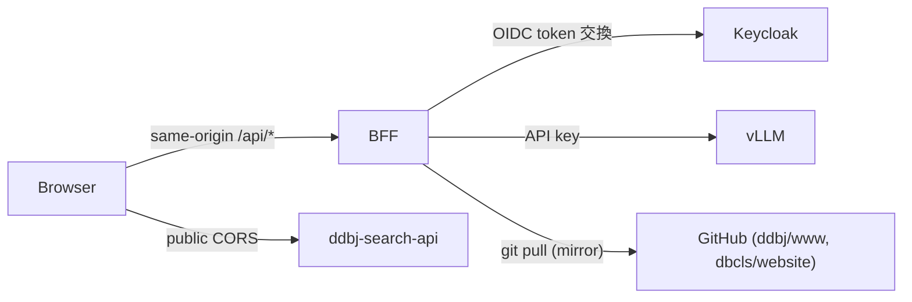
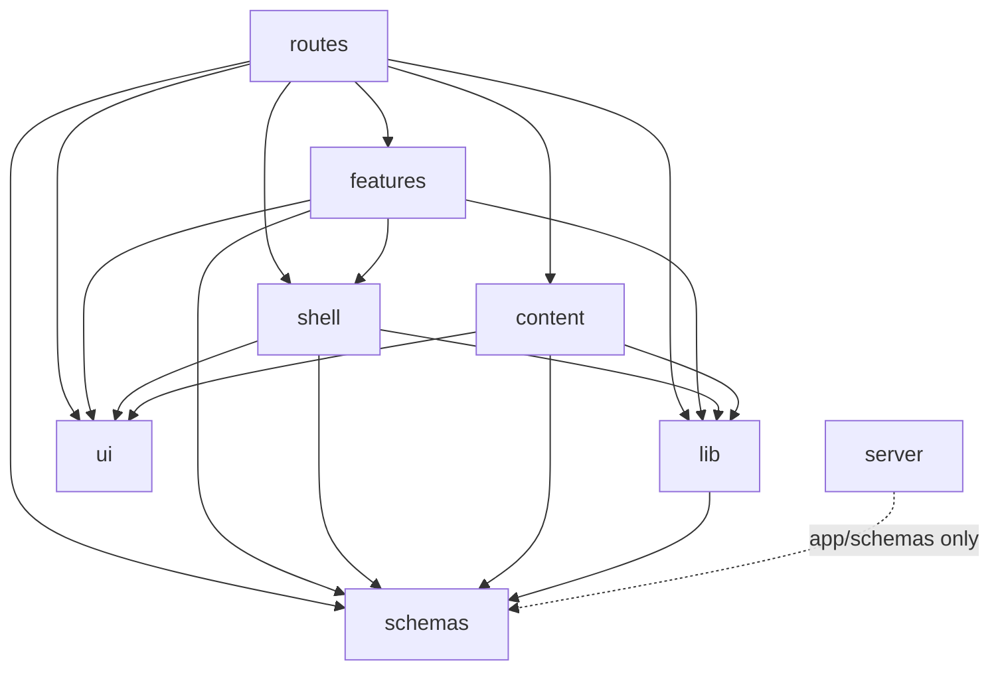

# Architecture

BSI (BioData Science Initiative) アプリ全体の構造。ブラウザ・BFF・外部 API の 3 段構造、`app/` の zone 分割と import 方向、SSR と CSR の境界、build 時と runtime の境界、routing、性能、セキュリティ、アクセシビリティを扱う。

## 全体構造

ブラウザ、BFF (Backend For Frontend、`server/`)、外部 API の 3 段構造を取る。server 側でしか行えない外部接続 (Keycloak との token 交換、API key を要する vLLM、GitHub の repository の mirror) は BFF が行い、client (`app/`) は同一 origin の `/api/*` を呼べばよい。public な `ddbj-search-api` は例外で、ブラウザが BFF を経由せずに直接呼ぶ。

secret の扱い:

- secret (vLLM の API key) を要する外部接続は BFF だけが行う。Keycloak の client は public client で secret を持たず、GitHub の mirror は認証なしで pull する
- secret を含む環境変数をブラウザ bundle に含めない
- 各 BFF endpoint の request と response の形は、機能別の docs を SSOT とする

server 側で処理する endpoint:

| Endpoint | 機能 | SSOT |
|---|---|---|
| `/api/me` | 現在の session 情報 | [auth.md](auth.md) |
| `/api/auth/*` | OIDC のログイン / コールバック / ログアウト | [auth.md](auth.md) |
| `/api/news` | news mirror の集約レスポンス | [news.md](news.md) |
| `/api/services` | services mirror の集約レスポンス | [services.md](services.md) |
| `/api/llm/*` | AI クエリビルダーの SSE | [llm.md](llm.md) |
| `/api/set-lang` | 言語 cookie の更新 (303 redirect)。React Router の resource route | [i18n.md](i18n.md) |
| `/sitemap.xml` / `/robots.txt` | 検索エンジン向けのリソース | § sitemap.xml と robots.txt |

`app/lib/api/*` から呼ぶ ddbj-search-api の型生成と差分検知については、[api-types.md](api-types.md) を参照する。

## Zone 分割

`app/` を機能単位の zone に分け、zone 間で許す import の方向を ESLint の `import/no-restricted-paths` で検査する。違反すると lint が失敗する。許可の全体は `eslint.config.ts` の同 rule で定義し、この節の図はその要約である。

各 zone の役割:

- `schemas`: Zod による型と runtime validation。他の zone に依存しない
- `lib`: 純粋なユーティリティ (HTTP wrapper / i18n runtime / content loader / query client)。`schemas` だけに依存する
- `ui`: Tailwind の primitive。`@theme` token だけを参照する
- `content`: Service tile と submit の外部 CTA リンクを束ねる TypeScript collection ([content.md](content.md))
- `shell`: Header / Footer / NavBar / Breadcrumb のように、複数の画面で共通に使う部品
- `features`: ページごとの状態管理、reducer、modal
- `routes`: React Router v8 framework mode の route component。配線だけを書き、ロジックを持たない
- `server`: BFF。Node 専用で、`app/` の外に置く

許可する依存方向:

点線は例外として許す依存 (`server` → `app/schemas` のみ)。zone をまたぐ追加の規約:

- `features` 同士は直接 import しない。共通化するコードは `lib` / `schemas` / `ui` / `shell` のいずれかに移す
- `app` から `server` を直接 import しない。両方から使ってよいのは `app/schemas` だけである
- `routes` は全 zone を import できるが、ロジックを持たず配線だけを書く
- `features` / `routes` / `content` では、生の hex literal と arbitrary Tailwind value (`bg-[#...]` / `p-[3px]` 等) を禁止する。色と spacing は `app/styles/tailwind.css` の `@theme` token から生成した utility class で参照する ([frontend.md](frontend.md))

## SSR-CSR 境界

React Router v8 framework mode (`ssr: true`) で SSR し、ブラウザで hydration する。同じ `app/` のモジュールが Node とブラウザの両方で実行されるので、DOM / `window` / `localStorage` を使う処理は `useEffect` の中か、ブラウザで実行中かを判定する分岐の中にだけ書く。

import できる範囲はどの実行フェーズでも `app/` で同じである。フェーズごとの違いは、外部 I/O の経路にだけ現れる。

| 実行フェーズ | ランタイム | 外部 I/O の経路 |
|---|---|---|
| Server render | Node | `fetch(/api/*)` で `server/` を呼ぶ |
| Loader / Action (初回 SSR) | Node | `fetch(/api/*)` で `server/` を呼ぶ |
| Loader / Action (CSR navigate) | ブラウザ | `fetch` で `/api/*` を呼ぶ |
| Client hydration | ブラウザ | ブラウザ API だけを使う |

規約:

- loader は SSR と CSR で同じ 1 つを使う。`clientLoader` を別に宣言しない
- 同一プロセス上でも、`app/` から BFF を呼ぶときは `fetch(new URL("/api/...", request.url))` を使う。`server/` の関数を直接呼ぶと zone の import 規約に違反する
- `app/schemas` は `app` と `server` の両方から import できる。BFF の整形と client の表示で同じ schema を共有する

## Build-time と runtime

build artifact に含めるものと、起動時やリクエスト時に決まるものを分ける。secret は build artifact に入れず、すべて runtime で env から読む。

build 時に確定するもの:

- API 型 (`app/lib/api/openapi-types.ts`): `npm run gen:api-types` で生成して commit する ([api-types.md](api-types.md))
- Content collection (`app/content/**/*.content.tsx`): `import.meta.glob` で列挙し、import した時点で Zod schema で全件を validate する。1 件でも parse に失敗すると build が失敗する ([content.md](content.md))
- i18n リソース (`app/lib/i18n/resources/{ja,en}.ts`): 静的に import する。ja と en のキー集合のずれは PBT (property-based testing) で検出する ([i18n.md](i18n.md))
- Tailwind utility class: Vite が `@theme` block と JSX を走査し、使われている class だけを出力する

runtime に確定するもの:

- 環境変数: 起動時に Zod schema (`server/lib/env.ts`) で validate し、違反があれば server を起動しない。各機能の docs には変数名と意味の表だけを書き、default 値と型は `server/lib/env.ts` を参照する
- BFF の session store: in-memory で持ち、プロセスを再起動すると消える ([auth.md](auth.md))
- News / Services の mirror cache: disk に保存し、起動時に読み直す
- LLM の health 状態: server のメモリに保持する

環境変数の名前の接頭辞で、server 専用か client にも渡すかを区別する:

- server 専用の env は `DB_PORTAL_*`、client にも渡す env は `VITE_DB_PORTAL_*` にする
- `DB_PORTAL_*` の値を `VITE_DB_PORTAL_*` に写すのは `compose.yml` で行い、secret の変数は写さない

## Routing

URL の全構造は `app/routes.ts` で定義する。URL に言語識別子を含めず、言語は cookie で決める ([i18n.md](i18n.md))。BFF endpoint と client route のどちらが先に一致するかは、`server/index.ts` の mount 順で決まる。

- 各 DB の解説ページと汎用の static page は、`routes/page-content/route.tsx` の catch-all route (`/*`) が表示する。URL の path は `page-contents/` 内の path に一致させる
- `/auth/*` の client route には通常到達しない。BFF (`server/auth/routes.ts`) が先に 302 で redirect するためである。Keycloak 側の redirect_uri 設定の fallback として残す
- `/api/set-lang` は action を持つ唯一の resource route で、lang cookie を更新したあと 303 redirect で Referer に戻す
- BFF endpoint (`/api/me` / `/api/news` / `/api/services` / `/api/llm/*` / `/api/auth/*`) は `server/index.ts` で個別に mount し、React Router の catch-all より先に一致させる
- design preview (`/_design/*`) は `NODE_ENV !== "production"` のときだけ route に含める ([frontend.md](frontend.md))

### Route handle

各 route module は `export const handle` で静的な metadata を宣言する。`handle` は loader を実行しなくても `useMatches` から読め、SSR と CSR で同じ値になる。パンくずリスト、document title、en 翻訳の充足度のように複数ページにまたがる metadata を、この仕組みで route module から取り出す。

| handle key | 役割 | 詳細 |
|---|---|---|
| `breadcrumbI18nKey` / `breadcrumbResolver` | パンくずリストの segment (static / dynamic) | [content.md](content.md) § パンくずリスト |
| `titleSegments` / `titleResolver` | document title の segment (static / dynamic) | [i18n.md](i18n.md) § ページタイトル |
| `i18n.en` | en 翻訳の充足度 | [i18n.md](i18n.md) § handle.i18n.en |

resolver の dict は `app/shell/` で組み立てる。使える handle key の集合は、各 route file の `export const handle` で決まる。

### エラー境界

route が存在しないとき、または loader が `throw new Response("Not Found", { status: 404 })` を投げたときは、`app/root.tsx` の `ErrorBoundary` が 404 用の UI を表示する。5xx のときも同じ `ErrorBoundary` が汎用のエラー UI を表示する。stack trace はどの env でも UI に出さない。

## 性能

ユーザーの体感に影響する 3 指標について目標値を決める。

| 指標 | 目標 |
|---|---|
| LCP (top / 検索結果) | < 2.5 s |
| TTFB (SSR) | < 600 ms |
| 検索 API → 結果描画 (95p) | < 2 s |

達成手段:

- Vite と React Router framework mode による route 単位の code splitting
- Tailwind v4 による CSS の最適化
- Noto Sans JP Variable の self-host と `font-display: swap`
- TanStack Query の `staleTime` の調整

計測は Playwright e2e で `performance.getEntriesByType("navigation")` を取得し、staging で複数回試行して平均する。

## セキュリティ

`server/lib/security.ts` が全 HTTP response に security header を付与する。CSP の directive の値は `buildCspHeader` で定義する。

- `Content-Security-Policy`: script は request ごとの nonce で許可し、nonce の無い inline script を許可しない。style は Tailwind v4 の inline 出力を許容する。`connect-src` には ddbj-search-api の origin を runtime で加える。dev 環境では CSP header 自体を送らない
- `Strict-Transport-Security`: production だけで送る
- `X-Frame-Options` / `X-Content-Type-Options` / `Referrer-Policy`: 全 response に付与する

CSP nonce の受け渡し:

- server が request ごとに nonce を生成し、request header で root loader と entry.server に渡す。root loader と entry.server は、その nonce を `<Scripts>` / `<Links>` に渡す。header 名は `app/schemas/csp-nonce.ts` で定義する
- inline script は nonce で許可し、`script-src` に `'unsafe-inline'` を置かない

## アクセシビリティ

WCAG AA 相当を `@theme` token の段階で満たし、primitive ごとに上書きしない。見た目は `/_design` route で確認し、role と aria 属性は primitive 単位の unit test で assert する ([frontend.md](frontend.md) § アクセシビリティ)。

- 色のコントラストは `@theme` token の段階で AA を満たす
- focus ring は `*:focus-visible` に global で適用し、primitive 単位で上書きしない
- 全ページをキーボードで操作できる。modal は focus trap を持つ
- `<html lang>` は表示言語に合わせて動的に出力する ([i18n.md](i18n.md))

## sitemap.xml と robots.txt

検索エンジン向けのリソース。dev と staging では検索エンジンによる索引登録を拒否し、production だけで許可する。

- `GET /sitemap.xml` (`server/api/sitemap.ts`): content collection と静的 route のそれぞれについて `?lang=ja` と `?lang=en` の 2 つの URL を出力し、hreflang で相互に宣言する ([i18n.md](i18n.md))
- `GET /robots.txt` (`server/api/robots.ts`): production では全許可と Sitemap の場所を返し、dev と staging では全 disallow を返す
