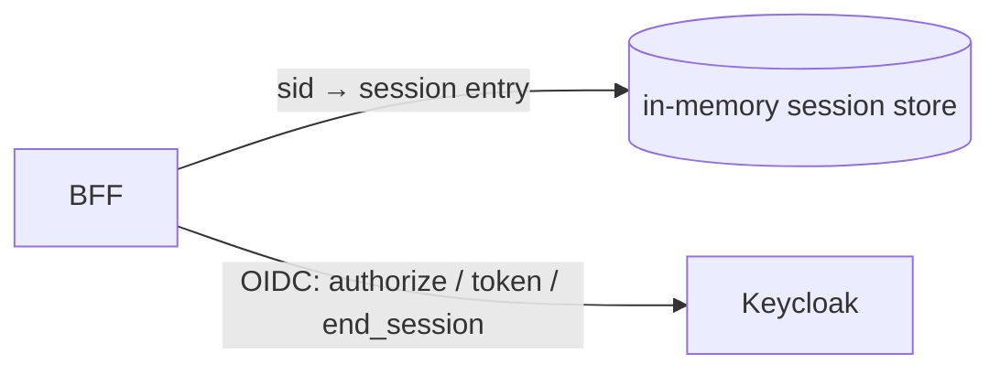

# Authentication

DDBJ Account (Keycloak) と OIDC (OpenID Connect) で連携する仕組み。BFF と HttpOnly cookie の組み合わせで、ブラウザ側の JS に token を渡さない。OIDC protocol の処理はすべて BFF (`server/auth/`) で行う。

## BFF + HttpOnly cookie パターン

ブラウザが受け取るのは、不透明な session id (`sid`) を値に持つ HttpOnly cookie だけである。BFF (Express) は Keycloak から受け取った token のうち `id_token` だけを in-memory の session store に保持する (§ session entry)。Keycloak とのやりとり (authorize / token / end_session) は BFF を経由し、React Router の loader / component は OIDC protocol を扱わない。BFF が secret を扱い client に出さない全体の方針は [architecture.md](architecture.md) を SSOT とする。



security の根拠は 2 つある:

- CSRF 防御: BSI は read-only で mutation API を持たないので、cookie の `SameSite=Lax` と OIDC の `state` の 2 つで防御が成立する
- XSS 耐性: token をブラウザに渡さないので、XSS が起きても token は漏れない。cookie の値も `HttpOnly` なので JS から読めない

公開する endpoint と env の一覧は § endpoint と環境変数 を参照する。

## OIDC PKCE フロー

BFF が Authorization Code + PKCE (S256) のフローを完結させる。login から callback、session の発行までを 1 つの sequence で行い、logout は別の 2 つの endpoint (`/api/auth/logout` と `/api/auth/logout-callback`) で行う。

### login と callback

BFF は login で `state` / `code_verifier` / `nonce` / `returnTo` を生成して pending store に保存し、callback で `state` を 1 回だけ取り出す。同じ `state` が 2 回来たとき、存在しない `state` が来たとき、または `state` が期限切れのときは、BFF は 400 を返し、session を作らない。

```mermaid
sequenceDiagram
  participant B as Browser
  participant S as BFF (server/auth)
  participant K as Keycloak
  B->>S: GET /api/auth/login?return_to=...
  S->>S: PKCE / nonce / state を生成し pending store へ
  S-->>B: 302 to Keycloak authorize (S256, nonce, state)
  B->>K: authorize (login UI)
  K-->>B: 302 to /api/auth/callback?code=...&state=...
  B->>S: GET /api/auth/callback
  S->>S: pending store から state を 1 回限り take
  S->>K: POST token endpoint (code + code_verifier)
  K-->>S: id_token + access_token
  S->>S: id_token claim 検証 / session 発行
  S-->>B: Set-Cookie sid; 302 returnTo
```

### id_token claim 検証

BFF は id_token を Keycloak の token endpoint から TLS で直接受け取る。そのため OIDC Core 1.0 の 3.1.3.7 (ID Token Validation) の項目 6 のとおり、JWT の signature 検証は TLS の server 検証で代替する。payload の claim は BFF が必ず検証し、失敗したら callback は 400 を返して session を作らない。

- 検証する claim と検証ロジックは `server/auth/oidc.ts` (`IdTokenPayloadSchema` + `extractUserInfo`) を SSOT とする
- `email` は OIDC では optional な claim である。値が無いときは無いまま session に保存し、placeholder で埋めない
- `nonce` は login 時に生成した値との完全一致を BFF が要求し、token の replay を防ぐ

### logout

`POST /api/auth/logout` は、ブラウザを `end_session_endpoint` に `id_token_hint` 付きで 302 redirect する。`id_token_hint` があるので Keycloak は confirm 画面を出さない。Keycloak が `/api/auth/logout-callback` に戻すと、BFF が session を削除し、cookie を clear する。logout を POST にするのは、`SameSite=Lax` の cookie が cross-site の form POST では送られず、CSRF による logout を防げるためである。endpoint、status code、error 識別子の詳細は `server/auth/routes.ts` を参照する。

## session entry と cookie

認証状態の実体は server 側の session entry で、ブラウザに渡す cookie はその entry を指す識別子に過ぎない。

### session entry

session entry の構造は `server/auth/session-store.ts` の `SessionEntry` (Zod) を SSOT とする。BFF は logout の `id_token_hint` に使うため `idToken` を保持し、access token / refresh token は BSI 側で使わないので受信直後に破棄する。TTL は sliding で、アクセスのたびに延長する。期限切れの entry は定期的な cleanup で破棄する。

- session 全体を log に出さない。debug log に出すのは `sub` / `name` までにする
- credential 系の key の redaction は `server/lib/log.ts` の `redact` が行う。規約は [llm.md](llm.md) § PII redaction を参照する
- session store は in-memory で単一プロセスを前提にする。複数プロセスの deploy は現状では対象外である
- TTL と cleanup 間隔の値は `server/auth/session-store.ts` を SSOT とする。TTL だけは `DB_PORTAL_AUTH_SESSION_TTL_SECONDS` で上書きでき、cleanup 間隔は hardcode する

### cookie

session entry を指す cookie の名前は `sid` である。値は session id の不透明な乱数だけで、token そのものや user info を含めない。有効期限は server 側の session TTL で管理し、cookie は session cookie (`Max-Age` 無し) にしてブラウザを閉じると消えるようにする。属性の値は `server/auth/cookie.ts` を SSOT とする。

cookie が満たす security 要件:

- `HttpOnly`: JS から cookie の値を読めないようにする (XSS で session id を露出させない)
- `SameSite=Lax`: cross-site の POST から始まる CSRF を防ぐ。mutation API は持たないが、防御を二重にする
- `Secure`: staging / production では cookie を平文の HTTP で送らない。dev は http なので例外である
- `Path=/`: sub-path に限定せず、portal 全体の navigation で同じ session を使う

## state と returnTo の二重防御

login flow の間に受け渡す一時的な値は、OIDC の `state` と `returnTo` の 2 種類である。どちらも client と server が独立に検証する。client の helper を経由せずに `/api/auth/login?return_to=//evil` のような URL を直接開かせる攻撃を server 側で必ず防ぐため、二重の検証を維持する。

- OIDC の `state` は authorization request と callback を結ぶ CSRF token である。BFF は login で乱数を生成して pending store に保存し、callback で取り出す。攻撃者が用意した callback の URL を被害者に開かせても、BFF は拒否する (§ login と callback)
- `returnTo` は同一 origin の絶対パス (`/` 始まりで、`//` や `/\` を含まない) だけを受け付ける。条件に合わないときは `/` に正規化する
- `returnTo` の検証は client の helper (`app/lib/auth/login-url.ts`) と server の handler (`server/auth/return-to.ts`) がそれぞれ独立に行う

## ブラウザ側の認証状態

OIDC の code 交換、id_token の検証、cookie の発行、logout は BFF (`server/auth/`) で行い、React Router 側は cookie を付けて `/api/me` の 1 endpoint を呼ぶだけにする。この分離により、Keycloak 側の `Valid Redirect URIs` が React Router の routing の変更に影響されず、SPA bundler の bug や JS 無効の環境でも認証 flow が壊れない。

### `/api/me`

`GET /api/me` は cookie の `sid` から session を探す。session が有効なら 200 と `{ user: UserInfo }` を返し、cookie が無いか session が期限切れなら 401 と `{ error: "unauthorized" }` を返す。ブラウザは id_token を decode せず、user 情報は常に server から受け取る。response の形は `app/lib/auth/types.ts` の `MeResponse` schema (Zod) を SSOT とする。handler (`server/api/me.ts`) は TS の型だけで同じ形を返し、ブラウザ側は `MeResponse.parse` で再検証する。BFF の出力も信頼境界の外として扱うためである。

handler は response に `Cache-Control: no-store` を付ける。client 側の cache は TanStack Query の `staleTime` で制御する。

### useAuth と loader 統合

- `useAuth` は client component 用の hook で、`/api/me` の状態を `app/lib/auth/types.ts` の `AuthState` (discriminated union) に正規化する
- `<RequireAuth>` は `unauthenticated` のとき、`buildLoginUrl(location.pathname + location.search)` の URL に navigate する
- React Router の loader から認証状態を見るときは `loadAuth(request)` を使う。`loadAuth` が `Cookie:` ヘッダを BFF の `/api/me` に転送する。`app` から `server` を直接 import しない
- 言語の選択は cookie で維持するので、`/api/auth/login` / `/api/auth/logout` の path に言語を含めない ([i18n.md](i18n.md))

### 補助 routes

`app/routes/auth/{callback,silent-callback,logout-callback}.tsx` は、BFF を経由せずにこれらの URL を直接開いたときや、5xx のときに表示する fallback page である。loader を持たず、ホームへの link を表示するだけである。silent renew (iframe) は採用しないが、`silent-callback` の route は互換のために残す。OIDC の endpoint と URL は `server/auth/routes.ts` を SSOT とし、client 側の helper (login URL の組み立てと `returnTo` の検証) は `app/lib/auth/login-url.ts` に集約する。

## Keycloak realm と client

BSI が前提とする Keycloak の設定を書く。dev / staging は同じ realm を共有して client を env 別に分け、production は完全に独立した realm を使う。client は public type で PKCE を強制し、client secret を持たない。

| 項目 | 設定 |
|---|---|
| Client Protocol | `openid-connect` |
| Access Type | `public` (PKCE で代替、client secret なし) |
| Standard Flow | ON |
| Implicit / Direct Access Grants / Service Accounts / Authorization | OFF |
| PKCE Code Challenge Method | `S256` 強制 |
| Front Channel Logout | OFF |
| Backchannel Logout URL | 空 (logout は `end_session_endpoint` への 302 redirect で行い、backchannel は使わない) |

`Valid Redirect URIs` / `Valid Post Logout Redirect URIs` / `Web Origins` にはワイルドカード `*` を使わず、env ごとに `<DB_PORTAL_PORTAL_ORIGIN>` 配下の BFF endpoint を完全一致で登録する。production の client の redirect URI に staging の origin を含めない (逆も同様)。silent renew (iframe) は採用しないので、3rd-party cookie に依存しない (§ 補助 routes)。

BSI が要求する scope は `openid` / `profile` / `email` の 3 つに固定し、`offline_access` は要求しない。realm の "Client Scopes" で、この 3 scope を client の Default Client Scopes に紐づける。

BSI は `id_token` だけを保持する (`id_token_hint` 用) ので、Access Token / Refresh Token Lifespan は BSI の動作に影響せず、realm 全体のポリシーに従う。BSI session の実効 TTL は env `DB_PORTAL_AUTH_SESSION_TTL_SECONDS` で独立に決め、Keycloak の `Client Session Idle` と同じ値にする。

## endpoint と環境変数

### HTTP endpoint

BFF が公開する HTTP endpoint と動作 (path / status / redirect / error 識別子) は `server/auth/routes.ts` と `server/api/me.ts` を SSOT とする。[architecture.md](architecture.md) § 全体構造 の endpoint 一覧に auth 系の path がある。

### 環境変数

env の定義 / 型 / default は `server/lib/env.ts` の Zod schema が SSOT で、値は `env.staging` / `env.production` 等が SSOT である。この文書に関わる env:

- `DB_PORTAL_KEYCLOAK_REALM_URL`: Keycloak の realm URL。`id_token.iss` の検証にも使う
- `DB_PORTAL_KEYCLOAK_CLIENT_ID`: client ID。`id_token.aud` の検証にも使う
- `DB_PORTAL_PORTAL_ORIGIN`: BSI 自身の origin。redirect_uri と `/api/me` の転送先はこの値を SSOT とする。BFF 宛先の origin は `request.url` ではなく必ずこの env から取り、`Host:` ヘッダの改竄で転送先が変わらないようにする
- `DB_PORTAL_AUTH_SESSION_TTL_SECONDS`: session の sliding TTL
- `DB_PORTAL_TRUST_PROXY`: Express の `trust proxy` 設定。client IP を使う機能 ([llm.md](llm.md) の rate limit 等) があるので、reverse proxy の背後で動かすときは proxy の段数に合わせる
- `DB_PORTAL_E2E_USER_PASSWORD`: e2e の実行者が shell に設定する secret (staging のみ)。BFF は参照せず `tests/e2e/fixtures/users.ts` だけが読むので、server の env schema には含めない

env の切り替えは [development.md](development.md)、環境ごとの実値の所在は [deployment.md](deployment.md) を参照する。
