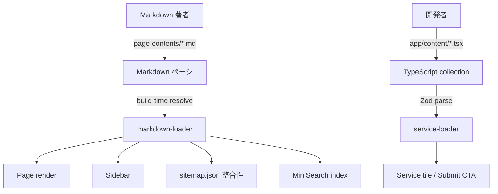
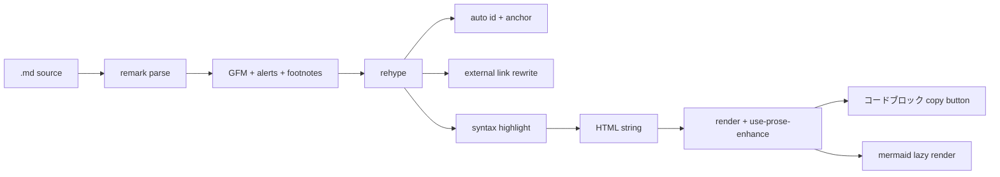
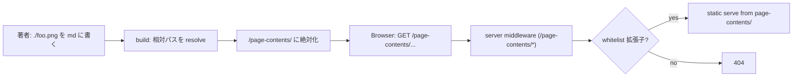
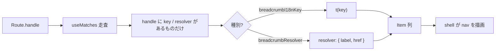
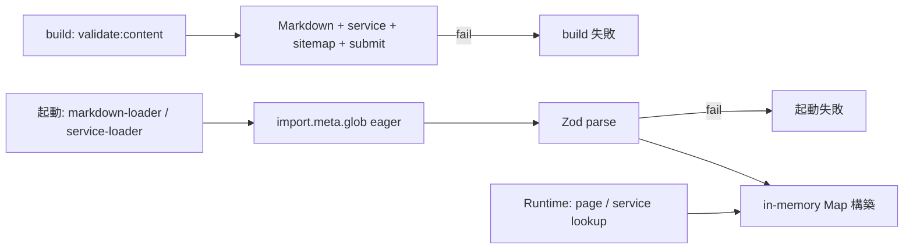

# Content

サイト内のコンテンツの仕組み。Markdown ページと TypeScript collection の 2 系統、URL 構造、Markdown パイプライン、asset 配信、Sidebar / パンくずリスト / 目次 (sitemap.json) / TOC の組み立て、全文検索、lastUpdated、i18n の境界、build と runtime の役割を扱う。

## 2 系統と URL 構造

コンテンツは、読み物と、データとして並べる要素の 2 系統で扱う。読み物は編集者 (非エンジニア) が Markdown で `page-contents/` に書き、データとして並べる要素は開発者が TypeScript で `app/content/` に書く。置き場所を分けることで、編集者と開発者はそれぞれ別のファイルを編集する。



Markdown ページの URL は、`page-contents/<path>/index.md` に対して `/<path>` になる。フォルダ構造が唯一の分類で、著者はカテゴリを指定しない。frontmatter に書く項目は `title` と `description` だけである。更新日は frontmatter に書かない (§ lastUpdated)。

TypeScript collection (`app/content/*.tsx`) は、Service tile (top page と `/services` に並ぶサービスカード) と、submit feature の外部 CTA リンクを 1 つの collection にまとめたものである。DDBJ / DBCLS の外部サービス一覧は別の仕組みで、services mirror が取り込む ([services.md](services.md))。

URL は言語を含まず (言語は cookie で決める。[i18n.md](i18n.md))、`/databases/<slug>` のようにすべてフラットで、nest しない。`/docs` は pathless layout (`app/routes/docs/layout.tsx`) の子として登録する。`databases/:slug` も同じ layout の子にする。URL は `/docs/` の下に nest しない。`/docs` が `?q=` の有無で目次と全文検索を切り替える仕組みは § 全文検索 で扱う。

- パンくずリストは、`/docs` を指す「ホーム」を先頭に、URL の segment ごとの index ページのタイトル、最後にページのタイトルの順に並べる (§ パンくずリスト)
- `server/api/sitemap.ts` の `STATIC_PATHS` に `/docs` を含める。Markdown ページ (`/databases/bioproject` 等) の path は `listContentPaths()` が `page-contents/` から自動で列挙する
- URL の末尾にスラッシュを付けない (dir も doc も `/path` の形)

## Markdown パイプライン

`app/lib/content/markdown-pipeline.ts` の unified pipeline が Markdown を HTML に変換する。使うプラグインとその順序は実装を参照する。ここには外向きに保証する機能だけを書く。



外向きに保証する機能:

- GFM 拡張 (テーブル、取り消し線、タスクリスト、脚注、`> [!NOTE]` のような GitHub blockquote alerts)
- コードブロックのシンタックスハイライト
- 見出しへの自動 `id` とアンカーリンクの付与
- 外部リンクへの `target="_blank" rel="noopener noreferrer"` の自動付与
- 本文中の生 HTML (`` 等) を hast の Element として扱う

Markdown から生成した HTML のスタイルは、`app/styles/tailwind.css` の `.prose-bsi` で定義する。`.prose-bsi` は `@tailwindcss/typography` の `prose` を元に BSI のデザイントークンで上書きし、`max-width` を `content-narrow` にして中央に揃える。

クライアント側では、`app/lib/content/use-prose-enhance.ts` が hydration 後に DOM を走査して 2 つの機能を加える。コードブロックのコピーボタンと、` ```mermaid ` ブロックを lazy load で SVG に描画する処理である。

## Asset 配信

著者は画像 / PDF を `.md` と同じ dir かそのサブ dir に置き、相対パスで参照する。著者は `public/` の階層を意識しなくてよく、asset はページ単位で完結する。



- build 時に、相対パス (`./foo.png` / `subdir/foo.png`) を md の dir を基点に絶対 path (`/page-contents/<full path>`) に変換する
- 外部 URL (`https://...`)、root-relative (`/foo.png`)、anchor (`#...`)、`mailto:` / `tel:`、拡張子の無いページ間リンクは変換しない
- `server/index.ts` の `/page-contents/<asset>` middleware が、`page-contents/` のファイルを static に配信する。dev と prod で同じ middleware を使う
- 配信する拡張子の whitelist は `server/index.ts` の `PAGE_ASSET_EXTENSIONS` で定義する。whitelist 外は 404 を返すので、`.md` 本文や非対応のファイルは外部から取得できない
- 参照先が存在しない相対パス (`./not-exist.png` 等) があると、build がエラーで止まる

ページ間リンクは絶対パス (`/databases/dra` 等) で書く。

## TS collection

`app/content/` 配下の TypeScript collection は、§ 2 系統と URL 構造 のとおり Service tile と submit feature の外部 CTA リンクをまとめる。フィールドの形と検証規則は `app/schemas/content/service-content.ts` の Zod schema で定義する。

- 1 ファイル = 1 Service とし、`*.content.tsx` の名前で `app/content/services/` 以下に置く
- `app/lib/content/loader.ts` が起動時に `import.meta.glob` で全ファイルを eager load し、Zod で parse する。1 件でも失敗すると起動が止まる
- collection は `loader` 経由でだけ参照する。features / shell から直接 import しない

`app/content/` 配下の TSX は content zone に属し、ESLint の `no-restricted-paths` が import できる範囲を制限する ([architecture.md](architecture.md))。content zone は `ui` / `lib` / `schemas` / `content` を import でき、`features` / `shell` を import できない。content のコードが features / shell の関数を呼ばないので、collection を副作用なく Zod で parse でき、起動時の eager load が安全に終わる。Markdown ページ (`page-contents/`) は TS ではないので、zone 制約の対象外である。

## TOC と h2 anchor

各 h2 見出しは `/<page>#<anchor>` の個別の URL を持つ。anchor の slug は `rehype-slug` と `github-slugger` が GitHub 風の規則で生成する。`app/lib/content/heading-extractor.ts` が、本文 HTML の `<h2 id>` と TOC の `id` が一致することを保証する。TOC の出力は、Sidebar の h2 の inline 展開 (§ Sidebar) と、全文検索の section 単位の doc (§ 全文検索) の両方で使う。

## Sidebar

全 content ページ (`/docs` 直下と `databases/:slug`) で共通の左サイドバーを使う。操作モデルは Confluence / Notion と同じで、キャレットは展開 / 折りたたみだけを行い、名前のリンクはページへの移動と自動展開を行う。

- キャレット (dir 行の先頭) を click すると、展開 / 折りたたみだけを行う
- ノード名のリンクを click すると、そのページを開き、そのノードを自動で展開する
- h2 の件数を示すトグル (h2 を持つ dir / doc) を click すると、そのページの h2 一覧を行の下に inline で展開する。h2 の anchor は § TOC と h2 anchor の slug と同じである
- 見出しの行を click すると `/path#anchor` に遷移する (同じページならスクロールする)

### ノード種別

content tree は `app/lib/content/content-tree.ts` の `getNavTree()` が返す。`getNavTree()` は初回の呼び出しで `listAllPages()` の URL segment をたどって tree を 1 度構築し、以降は同じプロセス内で cache した結果を返す。`_dev/` セクションは tree に含めない。

各 node は URL を持つかどうか (`hasPage`) でリンクの有効 / 無効が分かれる:

- 末端の doc と、`index.md` を持つ dir は URL を持つ。click でそのページに移動する
- `index.md` を持たない中間の dir は URL を持たず、子をまとめる label だけを表示する。click しても移動しない

### ツリーの表示

- 中間の dir の子はその下に並べ、グループ間は余白だけで区切る
- フォルダ / ドキュメントの種別を表すアイコンは使わない。種別はキャレットの有無で見分ける
- ネストは左の縦のガイドラインで表し、アクティブなページと見出しは brand 系の token で強調する
- 上部にツリー内を絞り込む入力欄 (debounce 付き) を置く。一致しないノードは隠し、一致した doc の親 dir は自動で展開して残す
- h2 は件数トグル経由で tree に統合する。h3 以下は本文で読むものとし、sidebar には出さない

## パンくずリスト

パンくずリスト (Breadcrumb) は content のファイルには書かない。各 route module の `handle` に i18n キー (`breadcrumbI18nKey`、static) または resolver 名 (`breadcrumbResolver`、dynamic) を宣言し、`app/lib/content/breadcrumb.ts` の `useBreadcrumb` が `useMatches` を走査して item 列を構築する ([architecture.md](architecture.md) § Route handle)。shell (`app/shell/breadcrumb.tsx`) が resolver を定義し、hook の結果を `<nav aria-label>` で囲んで表示する。



- `useBreadcrumb` は `useMatches` を順に走査し、handle に `breadcrumbI18nKey` か `breadcrumbResolver` を持つ match だけを item にする
- i18n キーが未定義のときも item を skip せず、i18next の default に従ってキー文字列をそのままラベルにする。dev で未定義のキーに早く気付くためである
- resolver が `null` を返した match は item にしない
- item が 1 つ以下のとき (`/docs` のように「ホーム」しか無いページ)、shell は何も render しない

shell は 2 つの resolver を定義する。`docs-root` は `/docs` の layout の handle が指定し、`/docs` を指す「ホーム」の item を返す。`page-content` は catch-all route の handle が指定し、URL の segment ごとに `index.md` のタイトルを label にした item を返す。タイトルが無い segment は segment の文字列を label にする。

タイトルは `scripts/gen-breadcrumb-titles.ts` が build 時に frontmatter から `app/lib/content/gen/breadcrumb-titles.json` に抜き出し、`app/lib/content/breadcrumb-titles.ts` が引く。shell から `markdown-loader` を import すると、unified pipeline を含む chunk が全ページに混ざるためである。

## /docs 目次 (sitemap.json)

`/docs` に表示する手書きの目次を扱う。crawler 用の `/sitemap.xml` ([public-api.md](public-api.md)) とは別のものである。

目次の内容は `page-contents/sitemap.json` に手書きし、サイドバー / 全文検索 / `/sitemap.xml` とは独立に管理する。`content-tree.ts` からの自動生成は使わない。dir 構造の alphabetical sort では意図した順序とグループ分けを表現できず、外部リンクの行も並べられないためである。ページを追加しても `sitemap.json` の更新は必須ではない。目次に出したいページだけを書く。サイドバーと検索は `page-contents/` の実ファイルから自動で生成する。

- section は `sections[]` に書いた順に表示する (sort しない)
- 各 item は `kind: "internal" | "external"` の discriminated union である
  - `internal` は `path` を必ず持つ。`/submit` のような、`page-contents/` に対応ページが無い feature page の path も書ける
    - `label` は optional で、書けばその値を表示し、書かなければ `page-contents/` の frontmatter の `title` を表示する
    - `label` が無く、対応ページも無い item があると、module の load 時に throw する
  - `external` は `url` と `label.{ja,en}` を JSON に持ち、外部リンクのアイコン付きで表示する
- 各 section は `id` を持ち、React の key として使う
- schema は `app/schemas/content/sitemap.ts`、loader は `app/lib/content/sitemap-loader.ts` を参照する

### module の load 時の検証

loader は module の load 時に `sitemap.json` を検証し、次のときに throw する。

- Zod schema に合わない
- 同じ `internal.path` が複数の section に出てくる
- `section.id` が重複する
- `label` の無い `internal` item に対応するページが `page-contents/` に無い

## 全文検索

`/docs` は、URL の `?q=` が無ければ `map` (目次)、あれば `search` (全文検索) の mode になる。利用者が SearchBox に入力すると `?q=xxx` で search に入り、空にすると map に戻る。状態を URL に持つので、reload、URL の共有、ブラウザの戻るが成立する。

`/docs` の全文検索の index は、`app/lib/content/search-index.ts` が MiniSearch でクライアント側に構築する。index は ja / en 別に持つ。title、description、body の順に重みを大きくしてランク付けし、prefix 検索と fuzzy 検索に対応する。boost の値は `search-index.ts` を参照する。

- index にはページ単位の doc と h2 section 単位の doc を混在させ、`kind: "page" | "section"` で識別する
- section の hit は、親ページのタイトル、見出し、section のスニペットを 1 行にまとめて表示し、click で `/page#anchor` に直接移動する
- section の hit は 1 ページにつき最も score が高い 1 件だけを表示する
- スニペットの強調には `<Mark>` primitive を使い、`dangerouslySetInnerHTML` を使わない

## lastUpdated

各 `.md` の最終更新日時は、build 時に `scripts/gen-last-updated.ts` が `git log -1 --format=%cI` で取得する。`index.md` (ja) と `index.en.md` (en) の日時は別々に記録する。`markdown-loader.ts` がその記録を読み、page lookup の戻り値に `PageContent.lastUpdated?: { ja?, en? }` として含める。著者は frontmatter に日付を書かない。日付の SSOT は git の commit である。

- 出力先は `app/lib/content/gen/last-updated.json` (gitignore 対象の build 成果物)
- `package.json` の `dev` / `build` / `start` の前段で `gen:last-updated` を実行する
- CI では `.github/workflows/ci.yml` の `actions/checkout` に `fetch-depth: 0` を設定する。shallow clone では古い commit の履歴を取れないためである
- 取得に失敗したときはスクリプトが `lastUpdated` を `undefined` にし、UI は「更新日不明」として扱う

## i18n の境界

i18n の仕組みは [i18n.md](i18n.md) で扱う。ここには content 側で守る境界だけを書く。

- Markdown ページ: `index.md` が日本語 (default)、`index.en.md` が英語で、各ファイルは 1 言語だけで書く。`index.en.md` が無いときは日本語を表示し、翻訳未提供の banner を出す
- TypeScript collection (`ServiceContent` 等): 各フィールドに `{ ja, en }` の両方を持たせる。片方が欠けたときに null を許すかどうかは schema でフィールドごとに決める
- `/docs` の UI 文言: i18n の namespace は `docs.*` である。ja / en のキー集合を同一に保つ規則は [i18n.md](i18n.md) で扱う

## Build と runtime

content 系の Zod parse はすべて build 時か起動時に終え、request の処理中には parse しない。



| フェーズ | 何が起きるか |
|---|---|
| build 時 | `validate:content` が Markdown ページ、service collection、sitemap.json、submit-routing catalog を Zod で parse する。1 件でも失敗すると build が失敗する |
| 起動時 | `markdown-loader` と service collection の `loader` が `import.meta.glob` で eager load し、Zod で parse する。1 件でも失敗すると起動が失敗する |
| runtime | page lookup / service lookup は、起動時に 1 度だけ構築した in-memory の Map から取得する |

`npm run dev` / `npm run start` / `npm run build` の前段で `npm run validate:content` を必ず実行し、collection の不整合を起動前に検出する。
