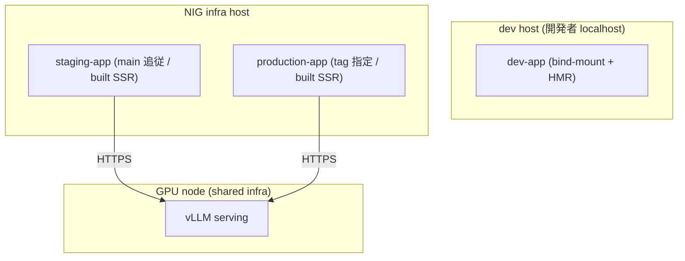
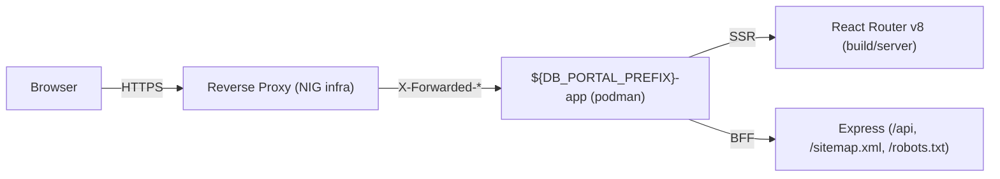
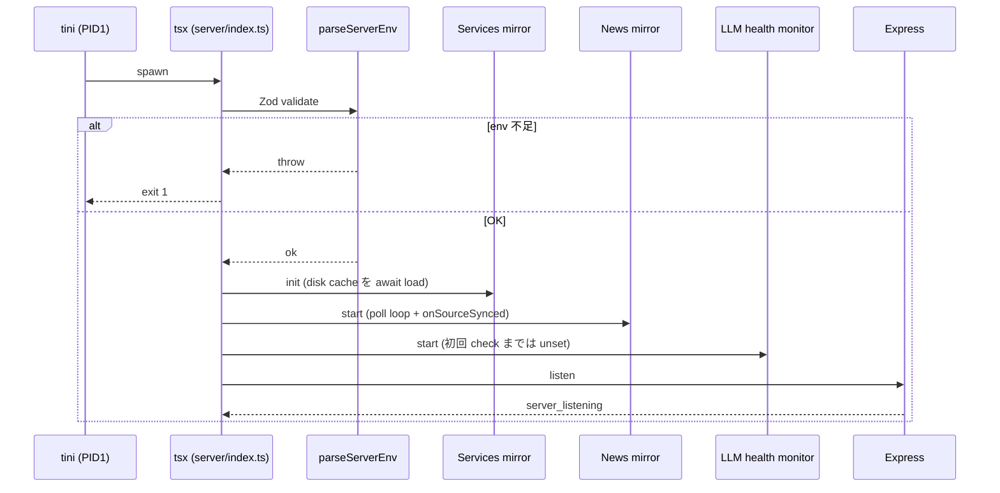

# Deployment

dev / staging / production の 3 環境の運用ガイド。staging と production は同一 host で同時に動かす。3 環境は同じ image と同じ compose ファイル群を使い、`${DB_PORTAL_PREFIX}` の値で名前の衝突を避ける。リリース手順、ログと監視、CI、トラブルシュート、secret rotation を扱う。

## 3 環境の構成

BSI は同じ image と同じ compose ファイル群から 3 つの環境を作る。dev は開発機の localhost で動き、staging と production は NIG infra 上の同一 host で同時に動く。LLM serving (vLLM) はライフサイクルが違うので、別 host の shared infra に置き、staging と production の app は同じ vLLM を HTTPS で呼ぶ。

| 環境 | 起点 | 起動形態 |
|---|---|---|
| dev | 開発者 localhost | source を bind-mount し、HMR で動かす |
| staging | NIG infra host | build 済みの SSR を image に含めて動かす。main に追従する |
| production | NIG infra host | build 済みの SSR を image に含めて動かす。tag を指定する |

具体的な SSH ホスト、deploy パス、環境別 (dev / staging / production) の env の実値は、このリポジトリには含めず、host 側に置く。

## Compose と overlay

base の `compose.yml` は production の形 (immutable な image、source の bind-mount なし) で書く。dev では `compose.dev.yml` を overlay として追加して bind-mount と HMR を有効にし、staging / production では `compose.podman.yml` を overlay として追加して rootless で動かす。同一 host 上で staging と production を同時に動かすため、`container_name` / `image` / `volume` / `network` の名前に `${DB_PORTAL_PREFIX}` を含めて衝突を避ける。

- `compose.yml` を SSOT とし、overlay には差分だけを書く
- `${DB_PORTAL_PREFIX}` は env ごとに別の値 (例: `staging` / `production`) にする。値が無いと 2 環境の名前が衝突し、container を起動できない
- `env.dev` / `env.staging` / `env.production` は git で管理する。secret の値は `CHANGE_ME` というプレースホルダにして commit する
- 実値は host 側の `.env.<env>.local` に置き、compose が起動時に `env_file` で merge する。`.env.*.local` は `.gitignore` で git の管理から外す

## container 構成

reverse proxy 1 段の背後で、podman の container 1 つが SSR と BFF の両方を処理する。BFF (`/api/*` / `/sitemap.xml` / `/robots.txt` を返す Express) と React Router v8 framework mode の SSR は、同じプロセスの中で動く。

container の `command` は npm を介さず、`tsx server/index.ts` を PID1 (`init: true` の tini) の子プロセスとして直接起動する。`SIGTERM` を node に直接届け、graceful shutdown の経路 (背景 timer の停止、idle な keep-alive 接続の切断、処理中の request の完了待ち、exit) を成立させるためである。npm を間に挟むと SIGTERM が node に届かず、強制 kill になる。

build と `validate:content` ([content.md](content.md)) は image の build 時に実行し、どちらかが 1 件でも失敗すると image の build が止まる。runtime stage は build 済みの `build/` をそのまま起動し、container の起動時に再 build も再 validate もしない。runtime の cache (news / repos / services) のみを `./cache:/app/cache` に置き、deploy をまたいで保持する。

container は reverse proxy 1 段の背後で動くので、`X-Forwarded-*` を信頼する trust proxy の hop 数を env (`DB_PORTAL_TRUST_PROXY`) で設定する。hop 数を誤ると、per-IP の rate limit と client IP の log が正しく動かない。

## 起動シーケンス

container の起動から listen までの順序は固定である。最初に env の検証を行い、失敗すると process は exit する。mirror と health monitor は listen の前に起動するので、Express が外部の request を受ける時点で cache は読み込み済みである。

起動時に動く subsystem は、外部の upstream を local に複製する mirror 群と、外部の vLLM の稼働状態を見る health monitor である。

- Services mirror ([services.md](services.md)) は init で disk cache の load を待ってから起動する。News mirror から source の sha の変化通知を受けると、該当する source を rebuild する
- News mirror ([news.md](news.md)) は disk cache を即時に load するので、cache が残っていれば `/api/news` は起動直後から item を返す
- LLM health monitor ([llm.md](llm.md)) は、初回の check が完了するまで `/api/llm/health` の `status` を `unset` で返す

## リリース

staging は main に追従して deploy し、production は SemVer の git tag (`v<MAJOR>.<MINOR>.<PATCH>`) を打ってから deploy する。deploy は同一 host の同じ port への in-place swap で、旧 container の停止から新 container の listen までの間だけ HTTP が応答しない。

- session は in-memory で永続化しないので、deploy / rollback / 再起動のたびに利用者は再ログインになる
- rollback は前の安定した tag を checkout して行う
- staging で問題のある commit が入ったときは、tag を戻すより `git revert` で main を修正する方が安全である
- リリースの直前に、production の env で `npm run gen:api-types` を再実行して production の `openapi.json` と BSI 側の型の差分を確認する。差分があれば反映してから tag を打つ ([api-types.md](api-types.md))
- News の disk cache は schema が一致しないとき空の cache に fallback する ([news.md](news.md))

deploy の実コマンド (SSH の接続先、podman の操作) は git で管理しない。

## ログと監視

外部の uptime monitor が 3 つの health endpoint を分単位で呼び、連続して失敗したとき alert を出す。deploy 中の swap の時間と区別するため、alert は連続失敗の閾値で発火させる。swap の時刻は、log の `server_shutdown` と `server_listening` を突き合わせて判定する。

- `GET /api/me`: session の確認。`Cache-Control: no-store` なので、監視の request は必ず origin に届く
- `GET /api/news`: News mirror の生存確認
- `GET /api/llm/health`: vLLM との疎通確認。`Cache-Control: no-store` で、`status` の意味は [llm.md](llm.md) を参照する

endpoint の response の形と status code は `server/index.ts` を参照する。

### ログ形式

`server/lib/log.ts` の logger は、構造化 JSON を 1 行 1 レコードで stdout に出力する。reverse proxy / podman / journald は stdout をそのまま収集すればよい。

| Field | 型 | 意味 |
|---|---|---|
| `ts` | string (ISO8601) | log の時刻 |
| `level` | `debug` / `info` / `warn` / `error` | severity |
| `msg` | string | snake_case の event 名 |
| ...payload | 任意 | event 固有のフィールド (redact 済み) |

event 名は snake_case にする。全 event の一覧は `git grep 'logger\.\(info\|warn\|error\|debug\)' server/` で取得する。logger は credential 系の field (Authorization / Set-Cookie / token 系 / API key / password / secret 等) の値を `[REDACTED]` に置換する ([auth.md](auth.md))。redact 対象の key は `server/lib/log.ts` の `REDACT_KEYS` を SSOT とする。session entry を丸ごと log に出すコードの経路は作らない。

## CI

`.github/workflows/ci.yml` は PR と `main` への push のたびに、Docker Compose 内で typecheck / lint / unit + PBT / `npm audit --audit-level=high --omit=dev` を実行する。deploy、e2e、openapi の差分検知、性能計測は CI から自動実行せず、人が手動で行う。

| 種類 | 自動 (CI) | 手動 |
|---|---|---|
| typecheck / lint / unit / PBT / audit | ◯ | - |
| deploy (staging / production) | - | ◯ |
| e2e (staging の URL に対して実行) | - | ◯ (`tests/e2e/notes.md`) |
| openapi 差分検知 (`gen:api-types`) | - | ◯ (リリース直前) |
| 性能計測 | - | ◯ |

## トラブルシュート

症状ごとに、確認する項目を順に調べて原因を特定する。具体的な podman コマンドと host 上の手順は git で管理しない。

| 症状 | 確認する項目 |
|---|---|
| News mirror が動かない (`/api/news` が空、`news_mirror_failed` が頻発) | host から `git ls-remote` で疎通できるか。env の repo URL / branch が正しいか。disk cache が壊れていないか (rename して再構築する)。source repo の history に問題が無いか |
| vLLM が unreachable | endpoint (`/v1/models`) に疎通できるか。`llm_health_transition` の推移。vLLM のプロセスが動いているか。timeout / base URL の env |
| LLM rate limit の誤発火 (`429 {error: "rate_limited"}`) | per-IP / per-session の limit の env。利用者が共有 NAT の背後にいないか |
| 認証 callback の state 不一致 | 古い tab からの request か。replay か。Keycloak の `Valid Redirect URIs` が設定とずれていないか |
| login の redirect ループ | `DB_PORTAL_PORTAL_ORIGIN` と Keycloak の `Valid Redirect URIs` が一致しているか |
| session が頻繁に切れる | session TTL の env と Keycloak の `Client Session Idle` のうち短い方が実効値になる。deploy 時に全 session が切れたかどうかは `server_shutdown` / `server_listening` を突き合わせる |
| CSP 違反 (ブラウザの console) | 新しい 3rd-party origin を追加していないか。inline の `<script>` / `<style>` に nonce を付けているか ([architecture.md](architecture.md)) |

mirror の cache の構造と schema の migration は [news.md](news.md)、認証フローの全体像は [auth.md](auth.md) を参照する。

## Secret rotation

secret は git に commit しない。実値は host 側の `.env.<env>.local` か、作業者の ssh client にだけ置く。rotation 後は、対応する log event か、次回のシナリオの成功で完了を確認する。

| Secret | 保管 | 周期 | 完了確認 |
|---|---|---|---|
| `DB_PORTAL_LLM_API_KEY` | host `.env.production.local` | vLLM 側の key 更新時 | `llm_health_transition` が `to: "ok"` |
| Keycloak client secret | 存在しない (public client + PKCE) | - | - |
| `DB_PORTAL_E2E_USER_PASSWORD` | リリースマネージャの作業環境 | 半年毎 / incident 時 | 次回の e2e の auth シナリオが pass する |
| Deploy host の SSH 鍵 | リリースマネージャの `~/.ssh/` | 半年毎 / incident 時 | 次回の deploy で SSH 接続に成功する |

News mirror が pull する repository は public なので、GitHub PAT 等の secret を持たない。

## 定期メンテナンス

| 周期 | 作業 |
|---|---|
| 週次 | `*_failed` event を集計し、件数の多いものを確認する |
| 月次 | News の disk cache のサイズを確認する |
| 半年毎 | SSH 鍵と e2e user の password を rotation する |
| リリース毎 | release announcement を公開し、production の `gen:api-types` の差分を確認する |

## 環境変数

env 全体の定義 / 型 / default は `server/lib/env.ts` の Zod schema が SSOT で、環境別の値は `env.dev` / `env.staging` / `env.production` が SSOT である。機能別の env は各 docs を参照する。deploy 時に特に注意する env:

- `DB_PORTAL_PREFIX`: container / image / volume / network の名前の prefix。同一 host で複数の環境を動かすため、env ごとに別の値にする
- `DB_PORTAL_PORTAL_ORIGIN`: BSI 自身の外向きの origin。Keycloak の `Valid Redirect URIs` と一致させる
- `DB_PORTAL_TRUST_PROXY`: `X-Forwarded-*` を信頼する Express の `trust proxy` 設定。reverse proxy の段数に合わせる
- `DB_PORTAL_LLM_API_KEY`: vLLM への認証 key (rotation 対象)
