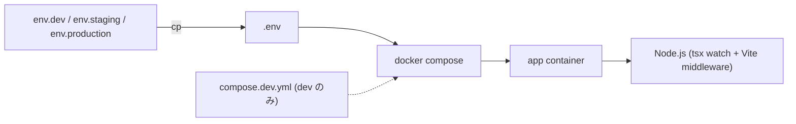

# Development

BSI を開発するためのローカル環境のセットアップと使い方。dev / staging / production は同じ `compose.yml` を使い、`.env` の中身で切り替える。開発コマンドはすべて container 内で実行する。

## 初回セットアップ

clone、`.env` の配置、container の起動、依存の install、API 型の生成を順に行う。`env.dev` は git に commit してあるので、そのまま `.env` にコピーしてよい。

```bash
git clone git@github.com:ddbj/db-portal ~/git/github.com/ddbj/db-portal
cd ~/git/github.com/ddbj/db-portal

cp env.dev .env
docker compose up -d --build
docker compose exec app npm install
docker compose exec app npm run gen:api-types
```

ブラウザで開く dev の URL は、`env.dev` の `DB_PORTAL_PORTAL_ORIGIN` の値である。`gen:api-types` は、ddbj-search-api の OpenAPI 仕様から `app/lib/api/openapi-types.ts` を生成する ([api-types.md](api-types.md))。

## env と Compose

開発も本番も同じ `compose.yml` を使い、`.env` の中身だけで環境を切り替える。dev だけは `compose.dev.yml` を override として追加し、source の bind-mount と dev server の起動を加える。`DB_PORTAL_PREFIX` の値が container / image / volume / network の名前に付くので、同一ホストで dev / staging / production を同時に起動しても名前が衝突しない。



git に commit する env ファイルは `env.dev` / `env.staging` / `env.production` の 3 つだけである。開発者はそのいずれかを `.env` にコピーして編集する。`.env` と `.env.*` は `.gitignore` で除外する。

- env の値域、default、型は `server/lib/env.ts` の Zod schema を SSOT とする。env を build 時に読むか runtime に読むかの境界は [architecture.md](architecture.md) を参照する
- 開発者が使う credential は staging までである。production の実値は `.env.production.local` から merge する ([deployment.md](deployment.md))
- `VITE_DB_PORTAL_` prefix の変数はブラウザ bundle に埋め込まれるので、secret に相当する値を入れていないことを必ず確認する
- `.env` を差し替えたら `docker compose down -v` の後に `docker compose up -d --build` を実行する。`restart` では新しい env が反映されない

切替例:

```bash
cp env.staging .env
docker compose down -v
docker compose up -d --build
```

dev / typecheck / lint / test / build / 依存の追加は、すべて container 内で実行する。ホストに Node を直接 install しない。本番は podman と podman-compose で同じ `compose.yml` を起動する。

- dev だけ `COMPOSE_FILE` で `compose.dev.yml` を追加し、source の bind-mount、`node_modules` の named volume、`build.target: dev` を設定する
- port を公開する bind 先のアドレスは `DB_PORTAL_APP_BIND_HOST` で決める。dev は loopback だけで待ち受ける。staging / production は別ホストの reverse proxy から接続を受けるので、全 interface で待ち受ける
- staging / production は、build 結果を含めた image の runtime stage を起動する
- 依存の解決結果をホスト環境に依存させないため、ホストで `npm install` を実行しない
- 依存を追加したら `package.json` と `package-lock.json` を必ず同じ commit に含める

## 開発コマンド

開発で使う npm コマンドはすべて `docker compose exec app npm ...` の形で実行する。ホスト側で直接実行する npm コマンドは無い。

```bash
docker compose exec app npm install
docker compose exec app npm install <pkg>
docker compose exec app npm install -D <pkg>

docker compose exec app npm run typecheck
docker compose exec app npm run lint
docker compose exec app npm run lint:fix

docker compose exec app npm test
docker compose exec app npm run test:unit
docker compose exec app npm run test:pbt
docker compose exec app npm test -- --watch

docker compose exec app npm run build

docker compose exec app npm run gen:api-types
docker compose exec app npm run validate:content
docker compose exec app npm run news:repos:sync
```

e2e は dev container では実行しない。staging に deploy した後、staging ホスト上の e2e 専用 container で実行する ([tests/README.md](../tests/README.md))。

## ファイル変更の反映

dev では、`tsx watch` が server を監視して再起動し、Vite middleware が SSR / CSR の bundle を作る。変更したファイルの種類で、自動で反映されるか手動の操作が要るかが決まる。

| 変更箇所 | 反映方法 |
|---|---|
| `app/**` / `server/**` の TS / TSX | `tsx watch` が自動で再起動する |
| `app/styles/tailwind.css` | Tailwind v4 plugin が即時に反映する |
| `app/content/**/*.content.tsx` の追加・削除 | `tsx watch` が再起動し、起動時に collection をまとめて validate し直す ([content.md](content.md)) |
| `page-contents/**/*.md` の frontmatter `title` | パンくずリストのタイトルは `npm run dev` の前段で `gen:breadcrumb-titles` が生成するので、`npm run dev` を実行し直す ([content.md](content.md)) |
| `app/lib/api/openapi-types.ts` | `npm run gen:api-types` を手動で再実行する |
| `package.json` | `docker compose exec app npm install` を実行する |
| `Dockerfile` / `compose*.yml` / `env.*` / `.env` | `docker compose down -v` の後に `docker compose up -d --build` を実行する |

`.md` の `lastUpdated` は、build 時のスクリプトが git の commit 日時から生成する ([content.md](content.md))。著者は手で書かない。

## CI

CI の内容は `.github/workflows/ci.yml` を SSOT とする。CI は container 内で typecheck / lint / test / 監査を実行する。開発者は PR を出す前に、同じコマンドを手元でも実行する。

```bash
docker compose exec app npm run typecheck
docker compose exec app npm run lint
docker compose exec app npm test -- --run
docker compose exec app npm audit --audit-level=high --omit=dev
```

監査の対象は production dependencies のうち severity が high 以上のものだけである。大きな変更をしたときは `validate:content` / `build` / `gen:api-types` も手元で実行する。`openapi-types.ts` に差分が出たら、同じ commit に含める。

## 環境変数

env の定義、型、default は `server/lib/env.ts` の Zod schema が SSOT で、環境別の値は `env.dev` / `env.staging` / `env.production` が SSOT である。env を build 時に読むか runtime に読むかの境界は [architecture.md](architecture.md) を参照する。開発でよく使う変数:

- `DB_PORTAL_PREFIX`: container / image / volume / network の名前に付ける prefix
- `DB_PORTAL_PORTAL_ORIGIN`: アプリ自身の origin。Keycloak の Valid Redirect URIs と一致させる
- `DB_PORTAL_OPENAPI_URL`: `gen:api-types` が ddbj-search-api の OpenAPI document を取得する URL
- `DB_PORTAL_KEYCLOAK_*`: Keycloak の realm / client 設定 ([auth.md](auth.md))
- `DB_PORTAL_AUTH_SESSION_TTL_SECONDS`: BSI session の sliding TTL ([auth.md](auth.md))
- `DB_PORTAL_LLM_*`: LLM BFF の接続設定 ([llm.md](llm.md))
- `VITE_DB_PORTAL_*`: ブラウザ bundle に埋め込む public な値。secret を入れない

container 内の実効値を確認する:

```bash
docker compose exec app sh -c 'env | grep ^DB_PORTAL_ | sort'
docker compose exec app sh -c 'env | grep ^VITE_DB_PORTAL_ | sort'
```

## トラブルシュート

まず env と volume を確認して対処し、それでも直らなければ個別の症状を調べる。

env と volume の確認:

- 依存や volume の不整合: `docker compose down -v` で named volume を破棄し、`docker compose up -d --build` で再構築する
- env の不一致: § 環境変数 のコマンドで container 内の実効値を表示し、`env.*` ファイルの値と比べる

個別の症状:

- lint の zones 違反: `app/features/*` 同士の import や、`app/lib` から `app/features` への import のような、禁止された方向の import が原因である。共通化するコードは `app/lib` / `app/schemas` に移す ([architecture.md](architecture.md) § Zone 分割)
- API 型の生成失敗: container 内から `DB_PORTAL_OPENAPI_URL` に到達できるか、upstream が応答するかを確認する ([api-types.md](api-types.md))
- Keycloak ログインの redirect ループ: `DB_PORTAL_PORTAL_ORIGIN` と Keycloak client の Valid Redirect URIs を比べる ([auth.md](auth.md))
- dev server の HMR が効かない: `vite.config.ts` の `server.host` / `server.port` と compose の port mapping が、dev の既定値 (container 側とホスト側で同じ port 番号) になっているかを確認する
