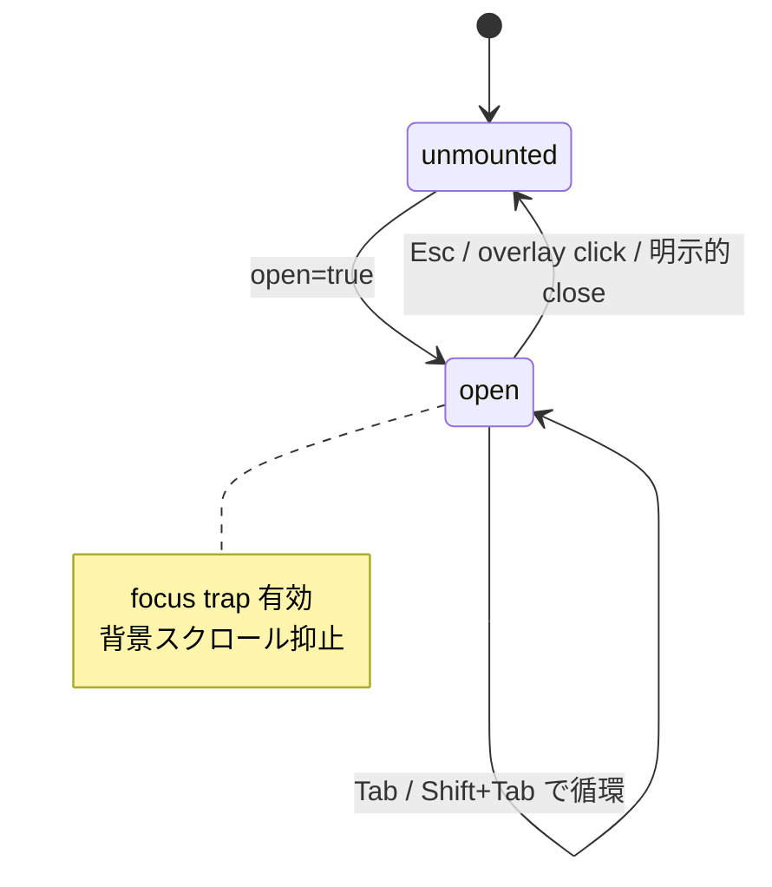

# Frontend

`app/ui/` の primitive デザインシステムの設計原則。zone 分割を前提に、設計トークン、primitive に共通の規約、Forms / Modal / Layout 系の個別の規約、アクセシビリティ、アイコン、視覚カタログ `/_design` を扱う。

## zone 分割

zone 全体の境界と依存方向は [architecture.md](architecture.md) § Zone 分割 で定義する。ここでは `app/ui/` (primitive zone) と `app/{features,routes,content}/` (上位 zone) に追加で課す制約だけを扱う。次の制約に違反すると ESLint (`eslint.config.ts`) が失敗する。

- `app/ui/` のコードは primitive と util だけを使い、他の zone を import しない
- `app/{features,routes,content}/` では、操作可能な native タグ (`<button>` / `<a>` / `<input>` / `<select>` / `<textarea>`) を直接書かず、primitive を使う
- `app/{features,routes,content}/` では、生の hex literal と arbitrary Tailwind value (`bg-[#...]` / `text-[14px]` / `p-[3px]`) を書かない
- `app/{ui,shell}/` は、arbitrary value の禁止の対象外である

## 設計トークン

色 / font / spacing / radius / shadow / tracking / leading の値は、`app/styles/tailwind.css` の `@theme` block で定義する。Tailwind v4 が token から utility class を自動生成する (例: `--color-brand` から `bg-brand` / `text-brand`)。アプリのコードは token 名でだけ値を参照する。

- token は utility class で参照し、px 値と hex literal を docs とコードに直接書かない
- 新しい色や spacing が必要なときは、先に `@theme` に token を追加し、その utility class を使う
- 半端な値 (0.5px 刻み等) は token にしない

`app/{ui,shell}/` に限り、arbitrary value を限定的に許す。対象は、token にする価値が薄い hairline、1 箇所だけで使う layout の値、`style={{}}` で動的に渡す値、`app/shell/` の vh / rem 単位の値である。同じ値を複数の箇所で使うようになったら、`@theme` の token にする。

## primitive

primitive は `app/ui/` にある最小単位の UI コンポーネントで、button / input / modal のように 1 つの責務だけを持つ。上位 zone は native タグの代わりに primitive を使う。1 primitive = 1 ファイルで `app/ui/*.tsx` に置き、`app/ui/index.ts` で re-export する。他の module は `import { Button, Tag, Modal } from "~/ui"` で参照する。個別 primitive の Props 型 / variant / class 構成は、実装と視覚カタログ (§ /_design) を SSOT とする。

### className

primitive は `className` prop を受け取らない。見た目の違いは `kind` / `tone` / `size` / `mono` / `selected` / `as` のような意味を持つ prop で表す。token を経由しない色や spacing を渡すコードは ESLint で禁止する。

レイアウトを微調整するときは、wrapper 要素で primitive を包むか、レイアウト primitive を組み合わせる。primitive の実装は `...rest` の spread を許すが、`className` だけは取り除いて渡さない。

### state 網羅

各 primitive は次の state を実装し、テストで確認する。操作できる primitive が、すべての state で定義どおりに反応することを保証するためである。

- default
- hover (clickable な場合)。背景色を surface 階調 1 段変える、interactive なアイコンの tone を変える程度は許容する。brand 色への大きな塗り変えは global focus ring に任せて避ける
- focus。global の `:focus-visible` の yellow ring を使う
- disabled。`aria-disabled` と `disabled` HTML 属性を常に同時に設定する
- checked / selected (該当する primitive のみ)
- loading (該当する primitive のみ)

### カテゴリ

役割が重複する primitive を増やさないために、primitive を責務でカテゴリ分けする。aria / focus / 高さの規約があるカテゴリは、右列の節を参照する。

| カテゴリ | 内容 | 詳細 |
|---|---|---|
| Page chrome | ページ wrapper、H1 と eyebrow、Top / Search / results で共通の検索 input | - |
| Layout wrapper | 垂直リズム、中央寄せ、横余白。段階は `--spacing-section-*` token で表す | - |
| Headings & Labels | main column 用と sidebar 用の見出し | § Layout 系 |
| Forms | native `<button>` / `<input>` の thin wrapper と、native `<select>` の代替である `Select` / `Combobox` | § Forms |
| Tags & Chips | Tag は操作できない label、Chip は操作できる pill | - |
| Facets | sidebar の facet UI | - |
| Callout | inline の notice。role は利用側が指定する | - |
| Modal | dialog (`Modal` root と Header / Body / Footer / Preview) | § Modal |
| Pagination / LinkCard | ページ送りとカード型 link | - |
| TextLink | 内部 link (React Router の `<Link>`) と外部 link を 1 つの primitive で扱う | - |
| InfoHint | ⓘ をトリガにして補足を表示する。native `title` を使わない | - |
| Segmented | 2 値以上を即時に切り替えるトグル | - |
| StableLabel | 取り得るラベルの最大幅を確保し、テキストの差し替えでリサイズしない | - |

## 個別 primitive

### Forms

`Button` を除く入力 primitive は、視覚的なエラー表示と、screen reader 向けの aria の関連付けの両方を満たす。入力 primitive の `state` prop は `default` / `warn` を取り、無効状態は別の boolean prop `disabled` で表す。

- `state="warn"` のとき、primitive が `aria-invalid=true` と `aria-describedby` を自動で付ける
- 利用側が `aria-describedby` を渡せるように、primitive はその prop を受け付ける
- error message を表示する側は、必ずその要素に id を付け、その id を input の `aria-describedby` に渡す
- `FormGroup` は `<fieldset>` と `<legend>` で実装し、radio / checkbox の群を screen reader が 1 つの質問として読み上げるようにする。子の input が 1 つでも `<fieldset>` で囲んでよい
- `IconButton` の default のサイズは WCAG AA の target size を満たす
- placeholder で state を表さない。placeholder は surface 上でコントラスト比 4.5:1 を満たす

### Modal

`Modal` と子 component (Header / Body / Footer / Preview) だけで dialog UI を構成する。`open=false` のとき Modal は何も render せず、mount するかどうかは親が決める。focus trap、背景スクロールの抑止、aria 属性の付与は Modal 自身が実装する。

- focus を dialog 内に保つ。open で dialog 内の先頭要素に focus を移し、Tab / Shift+Tab で dialog 内を循環し、close で trigger 要素に focus を戻す。focus trap は外部 dependency を使わず自前で実装する
- Esc キーと overlay の click で `onClose` を呼ぶ。`closeOnEscape={false}` / `closeOnOverlay={false}` でそれぞれ無効にできる
- overlay は pointerdown と click の両方で判定し、dialog 内で drag を始めて overlay 上で離したときに閉じないようにする (drag-out closure の防止)
- `role="dialog"`、`aria-modal="true"`、`aria-labelledby` を付ける。`aria-describedby` は渡されたときだけ付ける
- open の間は背景のスクロールを抑止し、close で元に戻す

### Layout 系

main column と sidebar は、heading の左バーの有無で見た目を区別する。main column 用の heading には装飾の左バーを付け、sidebar 用の heading には付けない。

検索 input は、入力モード (キーワード / 構造化条件) を切り替えても box の高さが変わらないように、高さ固定の variant で揃える (入力モードの使い分けは [search.md](search.md) を参照する)。query builder の行 (Select / TextInput / Combobox) も高さ固定の variant で揃える。

## アクセシビリティ

primitive ごとの aria の契約 (Forms の `aria-invalid` / Modal の `aria-modal` など) は § 個別 primitive で扱う。ここでは全 primitive に共通の規則だけを書く。

- 操作可能な要素は、primitive の内部で § zone 分割 に挙げた native タグを使って実装する。div / span に `role` を付けて代用しない
- focus の表示は global の `:focus-visible` の yellow ring に統一し、primitive ごとの focus 用 class を書かない
- icon だけの button には `ariaLabel` を必須にし、型で強制する
- `aria-disabled` と `disabled` HTML 属性を常に同時に設定する
- table には `<caption className="sr-only">` と `<th scope="col">` / `<th scope="row">` を付ける
- 自動検査は primitive 単位の unit test で role と aria 属性を assert する。axe のような専用ライブラリは使わない

色だけで意味を伝えない。status の意味は text label で示し、tone (色) は補強として使う。error / warning / 完了のように状態を強調する箇所では、icon と shape を併用して目立たせる。

## アイコン

SVG は `app/ui/icons/` に集める。装飾用と機能用で aria 属性の付け方を分ける。

- 装飾用の SVG には `aria-hidden="true"` を付ける
- 機能用の SVG は `aria-label` を持つ親の `<button>` の中に置き、ラベルは button 側に付ける
- フォルダ / ドキュメントの種別を表す汎用のアイコンは使わない。種別はキャレットや文脈で見分けられるようにする

## /_design

`/_design` route は、全 primitive の variant × state を並べて表示する。primitive の挙動を変えたとき、このページを開けば全 state の描画を回帰確認できる。

- `app/routes.ts` は `NODE_ENV !== "production"` のときだけこの route を含め、production build では除外する
- primitive を追加・変更したら、`/_design` で全 state が描画されることを確認する
