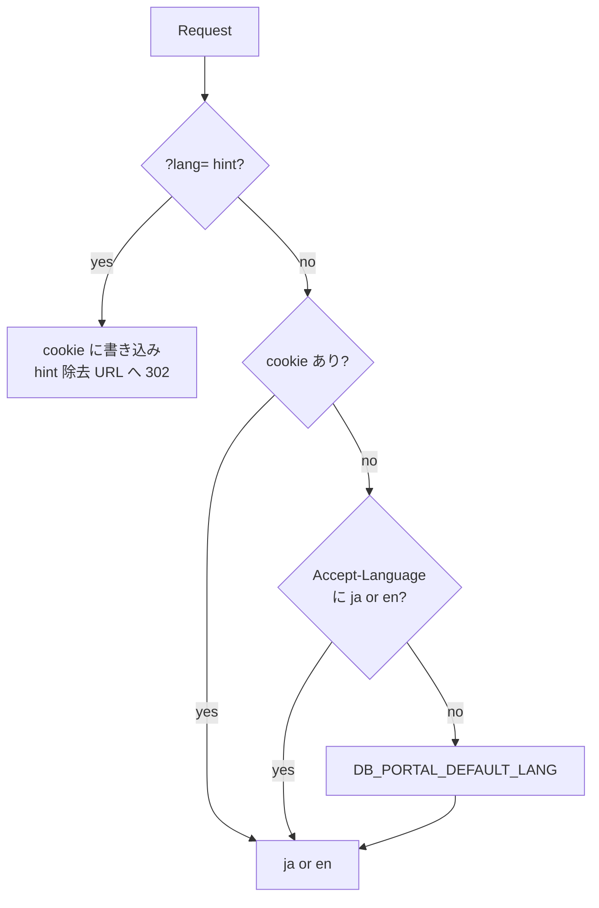
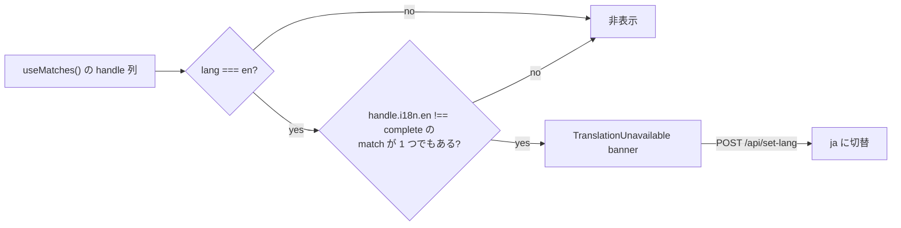

# Internationalization (i18n)

日本語 (`ja`) と英語 (`en`) の 2 言語を扱う仕組み。表示言語は URL に含めず cookie に保存し、root loader がリクエストごとに決めて Provider 経由で全 component に渡す。英語訳が無いときの fallback、言語切替、crawler 向けの宣言、ページタイトルも扱う。

## 言語解決

root loader がリクエストごとに表示言語を 1 つ決める。URL に `?lang` hint があれば root loader が先に処理し、無ければ `resolveLang()` が「cookie → Accept-Language → default」の順に評価して、最初に決まった値を loaderData に入れる。`LangProvider` がその値を全 component に渡し、翻訳文は request ごとに作る i18next instance が返す。利用者が言語を切り替えるときは、専用の resource route (§ 言語切替) に POST する。POST の後に React Router が loader を revalidate し、URL を変えずに画面が ja / en に切り替わる。

```mermaid
flowchart LR
  Req[Browser request] --> Loader[root loader]
  Loader -- "resolveLang()" --> Lang[ja | en]
  Lang --> LD[loaderData]
  LD --> Provider[LangProvider]
  Provider --> Cmp[全 component]
  Switch[SwitchLang UI] -- "POST /api/set-lang" --> Resource[set-lang route]
  Resource -- "Set-Cookie + 303" --> Req
```

### resolveLang

`resolveLang()` は cookie / Accept-Language / default の 3 段だけを評価する純粋関数で、`?lang` hint を引数に取らない。`?lang` hint は root loader が `resolveLang()` の前に処理する。root loader は hint の値を cookie に書き込み、hint を除いた URL に 302 redirect する。redirect 後のリクエストでは cookie から言語が決まる。`resolveLang()` は最初に解決できた段で確定し、後の段は評価しない。結果は必ず `ja` か `en` のどちらかになる。



- `?lang` hint を扱うのは root loader だけである
- `ja` / `en` 以外の値は無視して次の段に進む
- 実装は `app/lib/i18n/resolve-lang.server.ts`

### Cookie

決定した言語は `db_portal_lang` cookie に長期間保存する。sub-domain 間では共有しない。ブラウザの JS から参照できるように、`HttpOnly` は付けない。

- 値は `ja` / `en` の 2 値だけを受け付ける。他の値は無視して次の段に進む
- `SameSite=Lax` を付け、cross-site の POST から保護する
- `Secure` は runtime の環境で切り替え、production / staging で付ける
- `Path=/` にし、sub-domain と共有しない
- 寿命は年単位にする
- 属性の値は `app/lib/i18n/lang-cookie.server.ts` で定義する

### Provider

`LangProvider` は、root loader が決めた言語を React context として全 component に渡す。SSR と CSR の両方で言語の参照元を 1 つにするため、Provider の外で `useLang` を呼ぶと throw する。

- `useLang()` は現在の言語 (`ja` | `en`) を返す
- `useT()` は i18next の翻訳関数を返す
- 実装は `app/lib/i18n/lang-context.tsx` / `use-lang.ts` / `use-t.ts`

### i18next instance

`useT` が返す翻訳関数は、request ごとに新しく作る i18next instance を使う。module-level の global な instance を持たないので、SSR で並列に処理する request 同士で `changeLanguage` が競合しない。

- ja / en の 2 言語の resource は静的に import する。初期描画で必ず使うためである
- fallback 言語は ja に固定する (§ runtime fallback)
- 初期化は `app/lib/i18n/index.ts` を SSOT とする
- i18n の runtime コードは `app/lib/i18n/` に集約し、server 専用のファイルは `.server.ts` の suffix を付けて client bundle から除外する
- resource は `app/lib/i18n/resources/{ja,en}.ts` に置く。ja を SSOT とし、en は ja と同じキー構造に保つ
- アクセシビリティ用の文言は `a11y` namespace に分ける

## 翻訳なし fallback

en 表示中に翻訳が欠けているときは、互いに独立した 2 つの仕組みで扱う。1 つは i18next の runtime fallback で、キー単位で即時に ja の文言に置き換える。もう 1 つは route handle に基づく banner で、ページ単位で en 訳の状態を事前に宣言する。runtime fallback が起きたかどうかは、banner の表示判定に影響しない。

### runtime fallback

en で描画中にキーが en resource に無いときは、i18next が初期化時の `fallbackLng: "ja"` の設定に従って ja の値を返す。開発者が en 訳を書き忘れても、UI が空にならない。

- 置き換えの単位はキー (1 文字列) である
- 置き換えの条件は、en resource に該当キーが無いことである
- fallback 言語を ja に固定するので、ja resource を常に full set に保てば、en resource が subset でも UI が崩れない
- ja / en のキー集合の網羅率は PBT (`tests/pbt/lib/i18n/`) で測り、fallback が必要になる状態を事前に見つける

### TranslationUnavailable banner

route が `handle.i18n.en` に `complete` 以外の値を宣言しているとき、`app/shell/translation-unavailable.tsx` がページ上部に `<TranslationUnavailable>` banner を表示し、ja への切替の導線を出す。著者が「このページは en 訳が未整備である」と明示的に宣言するための仕組みで、キー単位ではなくページ単位で表示が決まる。



- component は active な全 match の handle を走査し、1 つでも `complete` 以外があれば banner を表示する
- `handle.i18n.en` を宣言していない route は判定から除外する。未宣言を「未整備」とは扱わない

### handle.i18n.en

各 route module は `export const handle` の `i18n.en` に、次の 3 値のいずれかを宣言する。banner を表示するかどうかはこの値だけで決まる。

| 値 | 意味 | banner |
|---|---|---|
| `complete` | en 訳がページ全体で揃っている | 非表示 |
| `missing` | en 訳が 1 行も用意されていない | 表示 |
| `partial` | en 訳の一部だけ用意されている | 表示 |

新しいページでは原則として `complete` を宣言し、en 訳の整備が間に合わないときだけ `partial` / `missing` を宣言する。宣言を省略した route は banner の判定から除外されるので、en 訳の状態を明示したいページでは必ず宣言する。

## 言語切替

`POST /api/set-lang` resource route で言語を切り替える。Header の SwitchLang ボタンも、TranslationUnavailable banner の「Switch to Japanese」も、この route に POST する。route は cookie だけを書き換え、URL は変えない。fetcher の submit 後に React Router が全 active loader を revalidate し、Provider の値が入れ替わって画面が in-place に再 render される。

- request の形式は `multipart/form-data` または `application/x-www-form-urlencoded` である。route は `lang` field を Zod (`"ja" | "en"`) で parse し、不正な値には 400 を返す
- 任意の `redirectTo` form field を受け付ける。same-origin の安全な path (`/` 始まりで、`//` や `/\` を含まない) だけを採用する
- response は 303 redirect である。`Location` は次の優先順で決める。(1) `redirectTo` form field、(2) Referer header (same origin のときだけ pathname + search を採用)、(3) `/`
- 同じ response に `Set-Cookie: db_portal_lang=...` を含める

## crawler 向け endpoint

crawler に言語別 URL を宣言する HTTP endpoint。i18n だけの話ではないが、hreflang と sitemap が言語別の URL を出力するので、この文書に置く。

### hreflang link

root の `meta()` は、現在の path について `ja` / `en` / `x-default` の 3 つの `<link rel="alternate">` を出力する。href は現在の path に `?lang=` hint を付けた URL にする。crawler がその URL を開くと、root loader が hint を cookie に書き込んで redirect する。`x-default` は ja を指す。

### sitemap.xml の hreflang

sitemap.xml は、Markdown ページと静的 route のそれぞれについて `?lang=ja` / `?lang=en` の 2 つの URL を `xhtml:link` で相互に宣言する。endpoint の仕様は [public-api.md](public-api.md) § `GET /sitemap.xml` を参照する。base origin の env は § 環境変数 を参照する。

## ページタイトル

document の `<title>` は、ブランド表記を一貫させるため、UI の言語に関わらず英語に固定する。i18n の例外としてここに書く。title は leaf 側の segment を先頭にして root 側に向かって並べ、末尾に `BSI` を付ける (パンくずリストの逆順)。

- `app/lib/content/page-title.ts` は leaf に近い route から順に `handle.titleSegments` (static) / `handle.titleResolver` (dynamic) を探し、最初に見つかった宣言の segment を使う
- どの route にも宣言が無いときは `BSI` だけになる
- handle の規約は [architecture.md](architecture.md) § Route handle を参照する

## 環境変数

env の定義 / 型 / default は `server/lib/env.ts` の Zod schema が SSOT で、値は `env.staging` 等が SSOT である。この文書に関わる env:

- `DB_PORTAL_DEFAULT_LANG`: 言語解決の最終段で使う default の言語
- `DB_PORTAL_PORTAL_ORIGIN`: sitemap と hreflang の URL の base origin
