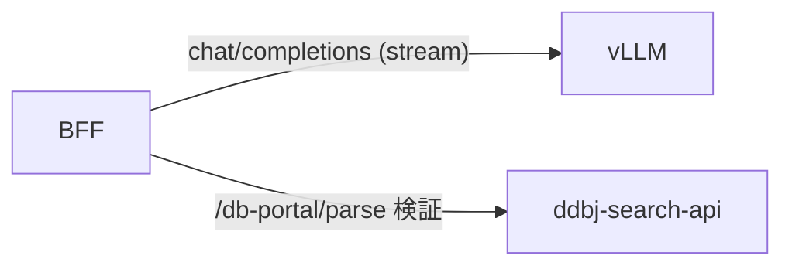
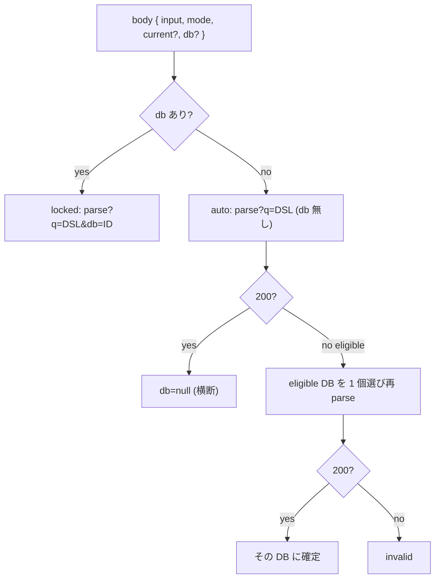
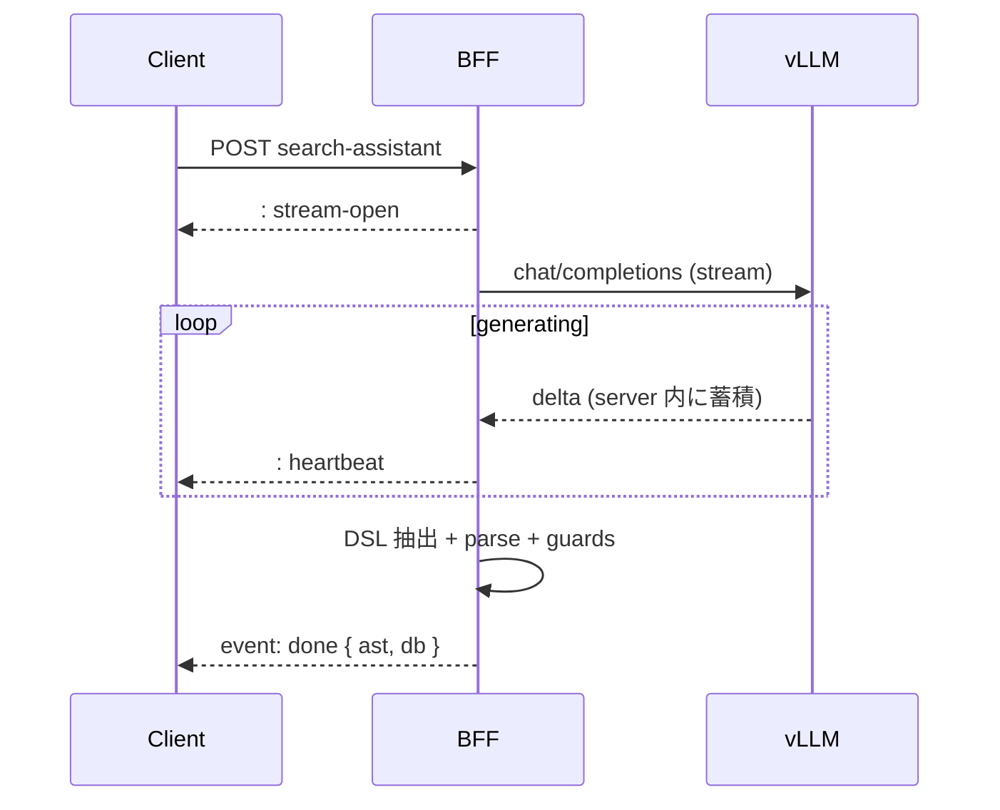
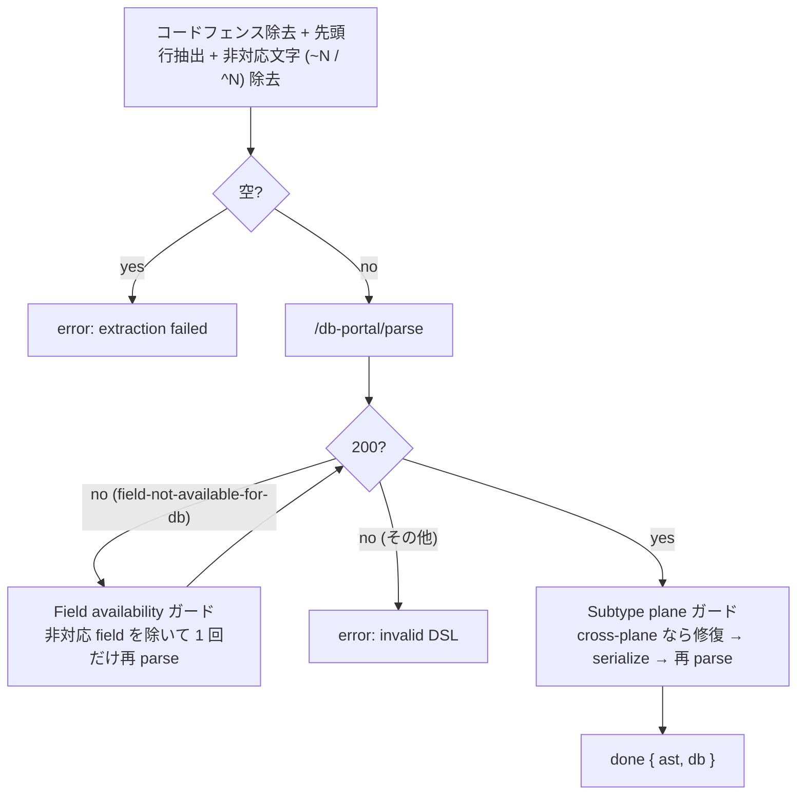
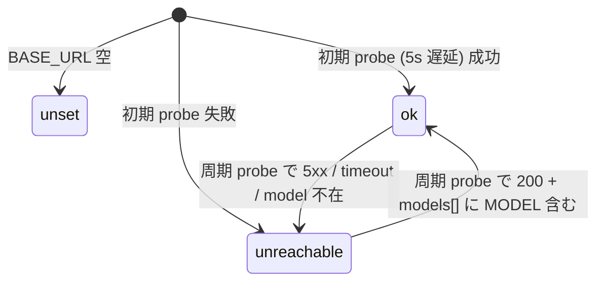

# LLM Integration

vLLM を内部の BFF 経由で使う AI クエリビルダー。ブラウザは vLLM の URL も API key も受け取らず、BFF が SSE (Server-Sent Events) の中継、vLLM への到達確認、rate limit、PII (個人情報) の redaction を行う。`/api/llm/search-assistant` の SSE protocol、DSL pipeline (抽出、parse、ガード)、health、rate limit、PII redaction を扱う。

## アーキテクチャ

通信はブラウザから BFF、BFF から vLLM の順に流れる。BFF は vLLM の credential をブラウザに渡さず、モデルが逐次出力する delta も client に転送しない。BFF が client に送るのは、検証済みの AST と DB slug を含む 1 回の `done` event だけである。vLLM の serving (GPU の割当、モデルの起動) はライフサイクルが別の GPU node 側の責務で、手順は `llm/README.md` に書く。staging と production の app は同じ vLLM インスタンスを使う。ブラウザと BFF の一般則は [architecture.md](architecture.md) を参照する。



BFF は任意の prompt を vLLM に転送する汎用の proxy にはしない。LLM を使う機能を追加するときは、BFF endpoint `/api/llm/<feature>` と prompt `server/llm/<feature>/prompt.ts` を 1 組で作り、client から BFF を経て vLLM に至る経路を共通にする。

## /api/llm/search-assistant

自然言語の入力を DSL に変換する SSE endpoint。client が POST すると、BFF が prompt を組み立てて vLLM に送り、モデルの出力を DSL として検証し、`done` event で AST と DB slug を返す。

### request body と Db スコープ

```http
POST /api/llm/search-assistant
Content-Type: application/json
Accept: text/event-stream

{
  "input":   "<natural language>",
  "mode":    "new" | "append",
  "current": <ParseNode AST>,
  "db":      "<db slug>"
}
```

`mode` を省略すると `new` になる。`append` のときは `current` が必須で、BFF は `current` を DSL に serialize して prompt に入れる。`db` の有無で処理は locked と auto の 2 つに分かれ、prompt で使う field の選択と DSL の検証経路が変わる (Tier の区分は [search.md](search.md) § Sidebar facet を参照する)。

- locked: body に `db` がある (per-DB ページから呼ぶ)。prompt は cross の field とその DB の Tier 3 field を使い、BFF はその DB で valid な DSL を返す
- auto: body に `db` が無い (top page / cross から呼ぶ)。prompt は cross の field を中心に使い、入力が明確に 1 つの DB の構造化された概念を指すときだけ Tier 3 field を使う。BFF は DSL 中の Tier 3 field から db を決める



auto で parse が失敗し、problem の `detail` が利用できる DB を示しているときは、BFF は `DB_PRIORITY` (`server/llm/assistant/search-api.ts` を SSOT とする) の順で DB を 1 つ選び、1 回だけ再 parse する。再 parse も失敗したら invalid にする。

### SSE response

response の event は `done` と `error` の 2 つだけで、モデルの逐次出力を送る `message` event は無い。BFF は生成中に `: heartbeat` だけを送り、中継の proxy が idle timeout で接続を切らないようにする。



- `done.data.ast` は `/db-portal/parse` で検証済みの ParseNode、`db` は確定した DB slug または `null` (cross 横断) である
- `error.data` は `{ code, message }` である (RFC 7807 の field 名を借用)。`code` の値域は `server/llm/assistant/{route,parse}.ts` で定義し、`message` は人が読める文である
- `error` を送った後、server は stream を close する。client は同じ event id で再 subscribe せず、毎回新しく POST する
- BFF は stream を開いた直後に `: stream-open` を 1 回送り、以降は周期的に `: heartbeat` を送る。間隔の値は `server/llm/sse.ts` で定義する
- BFF の rate limit を超えたときは、SSE を始める前に HTTP 429 を返す (§ Rate limit)
- client (`useAssistantStream`) は `done` を proposal の state に入れ、`error` を inline のエラー文言として表示する

## DSL pipeline

vLLM の出力 (1 行の Advanced-Search DSL 文字列) を `done` に入れるまでの処理。BFF は、DSL の抽出、`/db-portal/parse` による検証、2 つのガードによる決定論的な修復の順に処理する。Field availability ガードは parse が 400 を返したときに動き、Subtype plane ガードは parse が通った後に動く。修復後の再 parse に失敗したときは、修復前の parse 結果をそのまま使う。



### 抽出と parse

BFF は vLLM の出力からコードフェンスを除いて先頭行を取り出し、ddbj-search-api の `/db-portal/parse` で文法の allowlist と Tier 3 field からの DB 判定にかけ、AST と確定した DB slug を得る。BSI 側には field から DB への対応表を持たず、backend の判定を信頼する。

- DSL は `AND` / `OR` / `NOT` / グルーピングをすべて使える。抽出の実装は `server/llm/assistant/parse.ts`
- 非対応の文字 (fuzzy `~N` / boost `^N`) はモデルがまれに残すので、BFF が念のため除去する
- allowlist 外の field や構文エラーは `error` event にし、AST にできない出力は client に届けない。`error.message` は要求元自身の入力に対する検証結果なので、他の利用者の情報を含まない
- parse の base URL は `DB_PORTAL_SEARCH_API_URL` (検索 API と共用) を使う

### Field availability ガード

ddbj-search-api は一部の DB で Tier 1 / 2 の cross field を index に持たない (`_TIER12_UNAVAILABLE_DBS` を SSOT とする)。検索時は count=null として UI に出さないだけだが、parse は厳格で 400 `field-not-available-for-db` を返す。prompt で防ぎきれないモデルの prior による field の取りこぼしで結果を 0 件にしないために、BFF は locked または auto で解決した db で非対応の cross field を含む top-level の AND conjunct を決定論的に除き、同じ db で 1 回だけ再 parse する。この処理は `server/llm/assistant/search-api.ts` の parse の呼び出しの中で、`field-not-available-for-db` の 400 を受けたときだけ行う。

- OR group の中のように、bare な leaf でない箇所は変更しない
- 全 conjunct が非対応なら、元の 400 に戻す
- 固定値の field (`accessibility` のように public-access に集約されるもの) は対象外である
- 実装は `server/llm/assistant/field-availability-guard.ts` を SSOT とする

### Subtype plane ガード

sra / jga は subtype ごとに独立した doc を持ち、異なる plane (sample / experiment / analysis / run / study 等) の field を AND すると 0 件になる ([search.md](search.md) § Sidebar facet)。db が sra / jga に確定した AST が複数の plane にまたがるとき、BFF は sample plane の field (organism 等) と cross field を残し、experiment / analysis plane の field を除き、除いた主な sequencing の概念を free-text 1 語として条件に加える。

- この降格の規則は system prompt の規則と同じである
- BFF は修復後の AST を `/db-portal/serialize` で DSL にし、元のスコープで `/db-portal/parse` し直して canonical な `{ ast, db }` を得る
- 再 serialize / 再 parse に失敗したら、修復前の parse 結果に戻す
- 実装は `server/llm/assistant/plane-guard.ts` を SSOT とする

## /api/llm/health

機能が使えるか、upstream に届くかを `unset` / `ok` / `unreachable` の 3 状態で返す endpoint。状態は server の in-memory に保持し、handler は記録した値を返すだけで、request ごとに vLLM を呼ばない。response は `Cache-Control: no-store` で、schema は `app/schemas/api-bff/llm.ts` (client / server 共用) を SSOT とする。

`DB_PORTAL_LLM_BASE_URL` が空なら、状態は起動時に `unset` に確定する。設定されていれば、server の起動から 5 秒後の最初の probe の結果で `ok` / `unreachable` に確定し、以降は周期的な probe で `ok` と `unreachable` の間を遷移する。



状態別の挙動:

- `unset` のとき、`/api/llm/search-assistant` は 503 `{ error: "llm_unset" }` を返し、UI は AI クエリビルダーを表示しない
- `unreachable` のとき、UI は AI クエリビルダーを表示し、送信時の SSE の error 経路で失敗を伝える
- client (`app/features/search/assistant/llm-availability.ts` の `useLlmAvailability`) は TanStack Query で周期的に polling し、`ok` と `unreachable` なら `ready=true`、`unset` なら `ready=false` にする。dev server では health を参照せず、常に `ready=true` にする ([search.md](search.md) § LLM の可用性)
- dev では `DB_PORTAL_LLM_BASE_URL` を空にすると `unset`、dummy の URL にすると `unreachable` を再現できる

probe の周期、初期の遅延、probe の timeout の上限は `server/llm/health.ts` と `server/llm/client.ts` の定数で hardcode する。env には出さず、deploy 環境で変えない。

## Rate limit

BFF は per-IP と per-session の 2 軸の制限を両方適用し、先に超過した軸で 429 を返す。SSE を始める前の HTTP の段階で返すので、SSE の error 経路は通らない。

- per-session の制限は、`sid` cookie があるときだけ追加で適用する
- カウンタは 1 分粒度の固定 window で、in-memory の Map に持つ。1 instance と in-memory store の前提なので、window の境界での burst は許容する
- 超過時の response は HTTP 429 で、`Retry-After` ヘッダと body `{ error: "rate_limited", axis: "ip" | "session" }` を付ける
- client は他の error と同じ inline のエラー文言で表示する (専用の文言は持たない)
- 閾値、window 幅、cleanup 間隔は `server/llm/rate-limit.ts` と `server/lib/env.ts` を SSOT とする

複数 instance 化や共有 store の採用のときは、sliding window への切り替えも併せて検討する。切り替えの条件は [auth.md](auth.md) の session store と同じである。reverse proxy の背後で動かすときは、Express の `trust proxy` を [auth.md](auth.md) の `DB_PORTAL_TRUST_PROXY` で実際の段数に合わせる。合わせないと、per-IP の bucket が全 client で共有される。

## PII redaction

BFF は利用者の入力をそのまま prompt に組み立てて vLLM に送る。redact を行うのは server の log に出す直前だけで、モデルに渡す入力は変えない。

- 共通の log redaction (`server/lib/log.ts` の `redact`) は、key 名の一致 (case-insensitive、snake_case の表記揺れを含む) と、値のパターン (`Bearer` ヘッダの形 / JWT の形) の 2 層で行う
- LLM 用には、`server/llm/redaction.ts` の `redactUserInput(input)` を利用者の入力を log に出す直前に適用する。置換後の token はカテゴリ別の `[REDACTED_*]` の形式である
- 対象のカテゴリと regex pattern は `server/llm/redaction.ts` を SSOT とする。新しいパターンを追加するときは、PBT (`tests/pbt/server/llm/redaction-coverage.pbt.test.ts`) に「生の PII が出力に残らない」「安全な文字列は変化しない」の 2 つの性質の検査を追加する

## 環境変数

env の定義 / 型 / default は `server/lib/env.ts` の Zod schema が SSOT で、値は `env.staging` / `env.production` 等が SSOT である。この表は、BFF が読む env と、GPU node の serving 側 (`llm/compose.yml` + `entrypoint.sh`) が読む env の境界を示す。

| 変数 | 用途 | 読む側 |
|---|---|---|
| `DB_PORTAL_LLM_BASE_URL` | vLLM の base URL。空のとき AI クエリビルダーを表示しない | BFF |
| `DB_PORTAL_LLM_MODEL` | 使用する model 名。BFF と serving で同じ値を参照する | BFF + serving |
| `DB_PORTAL_LLM_API_KEY` | vLLM の API key。BFF と serving で同じ値を参照する | BFF + serving |
| `DB_PORTAL_LLM_TIMEOUT_MS` | upstream request の timeout。probe では 10s を上限に切り詰める | BFF |
| `DB_PORTAL_LLM_RATE_LIMIT_*` | per-IP / per-session の閾値と window | BFF |
| `DB_PORTAL_SEARCH_API_URL` | `/db-portal/parse` 等の base URL ([api-types.md](api-types.md) と共用) | BFF |
| `DB_PORTAL_TRUST_PROXY` | Express の `trust proxy` の段数 ([auth.md](auth.md)) | BFF |

この表に無い serving 専用の変数は、GPU node の `llm/compose.yml` + `entrypoint.sh` だけが読み、app は参照しない。dev は GPU が無いので、`env.dev` に serving 用の変数を置かない。
