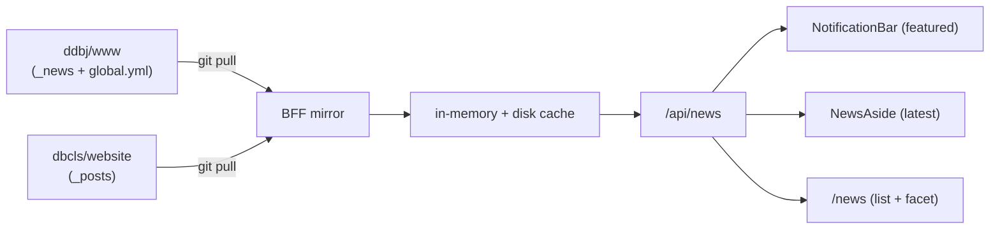
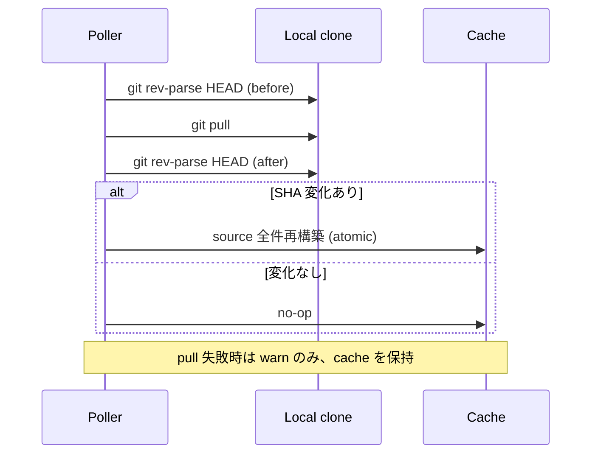

# News

BFF が ddbj/www と dbcls/website の 2 つのリポジトリを local clone として保持し、`git pull` で sync する。BFF はその結果から作った cache を `/api/news` の 1 endpoint で返し、NotificationBar、NewsAside、`/news` 一覧の 3 つの表示先が同じ cache を使う。

## news の役割

upstream のリポジトリを 1 次情報にし、外部 API を使わないために、BFF が ddbj/www と dbcls/website を local clone で持ち、定期的に `git pull` して全件を再構築する。ブラウザは `/api/news` だけを呼び、upstream、git clone、永続 cache のいずれにも直接アクセスしない。3 つの UI が同じ cache を、それぞれ別の条件で絞り込んで表示する。NotificationBar は featured の item だけを上部に表示し、NewsAside は最新 N 件を表示し、`/news` 一覧は facet 付きで全件を表示する。

cache の item は `featured` フラグを持つが、表示順と facet のグループ分けは cache に持たせず、UI と `/api/news` の query で導出する。

## mirror と sync

source ごとに独立した poller が動くので、一方の pull が失敗しても他方の更新は止まらない。poller は GitHub REST API を使わず、HTTPS 経由の git protocol で pull するので、REST API の rate limit の影響を受けない。

- poller は pull の前後で `git rev-parse HEAD` の結果を比べ、変更の有無をその比較だけで判定する。差分の commit は走査しない
- SHA が変わっていたとき、poller は partial update を行わず、その source の全件を再構築する
- pull に失敗したとき (network、branch 不在、破損) は、poller は warn を log に出すだけにし、既存の cache をそのまま残す
- source 別の repo URL / branch / clone 先 / file の配置は `server/news/sources.ts`、ポーリングの実行は `server/news/mirror.ts`、git 操作の wrapper は `server/news/git-sync.ts` を SSOT とする

## cache

cache は entity list の 2 段 cache の規約 ([entity-list.md § 2 段 cache](entity-list.md)) に従う。永続層の path は `<DB_PORTAL_NEWS_CACHE_DIR>/news.json` で、atomic に差し替える単位は ddbj / dbcls の 2 source である。

`NewsCache` / `NewsItem` の schema と `schemaVersion` の値は `app/schemas/api-bff/news.ts` を、永続化と atomic な差し替えは `server/news/cache.ts` を SSOT とする。

## NewsItem の正規化

cache の `items` の各要素 (`NewsItem`) は、ja / en の同じ記事を 1 件の pair にまとめた中間構造である。BFF は front matter (`tags` / `db` / `published` 等) と本文の Markdown から `NewsItem` を組み立てる。各 item は言語ごとの title / summary / url を持つ。

### ja/en pair のまとめ方

- BFF は source 単位で slug を key に `LangRawMap` で ja / en をまとめ、`NewsItem` の `id` を `${source}-${slug}` から導出する。この `id` を「内部 slug」と呼ぶ
- 片方の言語にしかない slug では、BFF はもう一方の言語の title を空文字にする。UI 側が lang fallback で表示する
- `published: false` の slug は、両方の言語で非公開のときだけ BFF が cache から除く。片方でも公開されていれば残す
- URL は front matter に持たず、BFF が source / lang / slug から組み立てる。該当する file が無い言語側の url は返さず、`url.ja` だけ、または `url.en` だけになる

### 分類 (種別とサービス)

BFF は `tags` を機能で分類する `NewsCategory` 型に正規化し、mapping に無い tag は `other` にする。UI を壊さないためである。`NewsCategory` が facet sidebar の「種別」の軸になる。

ddbj source の Database 区分 (BioProject / BioSample / DRA 等) は、`tags` ではなく `db` フィールドから取り、`NewsCategory` とは独立した「サービス」の軸として扱う。

front matter の parse、pair の結合、mapping、summary の抽出、`publishedAt` の合成は `server/news/normalize.ts` と `server/news/pair.ts` を SSOT とする。

## 3 つの表示先

同じ cache を、別の条件で絞り込んで表示する 3 つの UI がある。3 つは同じ TanStack Query key で `/api/news` を取得するので、request は共有される。

### NotificationBar

NotificationBar (`app/shell/notification-bar.tsx`) は、`featured=true` の item を全ページ共通の layout の上部に新しい順に積んで表示する。利用者は item を個別に閉じられる。この featured は、services 側の `featuredTop` (top page の services セクション限定) とは別の設定である。

- featured の元データは、ddbj source の `_data/global.yml` の `top_news.{ja,en}` (2 言語別の path の列) である
- dbcls source の item は常に `featured=false` である
- featured は `NewsCategory` (tag / category の体系) とは独立している。featured なら category を問わず NotificationBar に出し、featured でなければ category を問わず出さない
- featured の判定は mirror の再構築時に行う。`server/news/pair.ts` が `server/news/featured.ts` の `isFeaturedSlug` で path と内部 slug を照合し、結果を item の `featured` に入れる

### NewsAside

NewsAside は、`featured` かどうかを問わず、最新 N 件を compact な一覧で表示する。

### /news 一覧

`/news` route は SSR loader を持たない。client が URL から facet state を組み立て、`/api/news` を 1 回 fetch し、cache の全件 (当該言語で title を持つ item) から client 側で集計する。page / sort も同じ URL state に含める。

facet sidebar は、種別 (NewsCategory、enum)、ソース (ddbj / dbcls、enum)、年 (publishedAt、number)、サービス (db フィールド、string) の 4 グループで構成する。件数の集計、グループ間の AND とグループ内の OR、URL の serialize の規約は [entity-list.md § URL state と件数](entity-list.md) に従う。

URL state の parse / serialize は `app/features/news/facet-url-state.ts` を SSOT とする。

## /api/news と環境変数

### `GET /api/news`

endpoint は cache を filter して返す。全 query を AND で適用する。lang を指定したときは、その言語で title を持つ item だけを返し、summary の有無は判定に使わない。response には `Cache-Control: public` を付ける (`max-age` の値は `server/api/news.ts` を SSOT とする)。

query の仕様、response の schema、lang fallback の規約は `server/api/news.ts` と `app/schemas/api-bff/news.ts` を SSOT とする。

### 環境変数

env の定義 / 型 / default は `server/lib/env.ts` の Zod schema が SSOT で、値は `env.staging` 等が SSOT である。この文書に関わる env は、すべて `DB_PORTAL_NEWS_` で始まる:

- `DB_PORTAL_NEWS_DDBJ_REPO_URL` / `DB_PORTAL_NEWS_DBCLS_REPO_URL`: 各 source の clone 元 URL
- `DB_PORTAL_NEWS_MIRROR_DDBJ_BRANCH` / `DB_PORTAL_NEWS_MIRROR_DBCLS_BRANCH`: 各 source の branch
- `DB_PORTAL_NEWS_REPOS_DIR` / `DB_PORTAL_NEWS_CACHE_DIR`: local clone と永続 cache の配置先
- `DB_PORTAL_NEWS_MIRROR_INTERVAL_SECONDS`: source 別の poller の周期

どちらの repository も public なので、`git pull` は GitHub の HTTPS git protocol で認証なしに行う。services が同じ clone を参照する規約は [services.md](services.md) を参照する。
