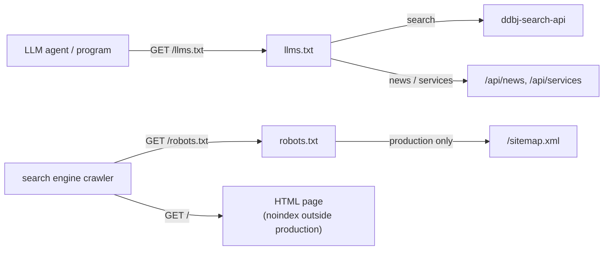

# Public API

BSI がプログラムと crawler に向けて公開する HTTP の入口。`/llms.txt`、`/robots.txt`、`/sitemap.xml`、production 以外の配置の noindex、`/api/` 配下の未知のアドレスへの 404 を扱う。BFF の各 endpoint の request と response の形は機能別の docs が扱い ([architecture.md](architecture.md) § 全体構造)、ddbj-search-api の型は [api-types.md](api-types.md) が扱う。

## Overview

人が読むページの他に、LLM の agent のようなプログラムと、検索エンジンの crawler がサイトを読む。プログラムには `/llms.txt` で API の場所を示し、crawler には `/robots.txt` と `/sitemap.xml` で読んでよい範囲を示す。production 以外の配置 (dev / staging) には production と同じ内容があるので、検索結果に production と並んで出ないように、crawler には閉じる。プログラム向けの入口は production 以外でも開ける。

| 環境 | robots.txt | sitemap.xml | noindex |
|---|---|---|---|
| production | `/search/results` と `/api/auth/` を Disallow し、Sitemap の場所を書く | 200 | 付けない |
| dev / staging | `/llms.txt` と llms.txt が案内する endpoint だけを Allow し、他を全て Disallow する | 404 | 全ページに付ける |

## 外向き契約

環境による分岐は `DB_PORTAL_ENV` が `production` かどうかで決める。URL の origin は `DB_PORTAL_PORTAL_ORIGIN` から組む。

### `GET /llms.txt`

LLM の agent のようなプログラムに、サイトの説明と API の場所を Markdown で示す (`server/api/llms.ts`)。

- 検索は ddbj-search-api を案内する。検索ページがその API を直接呼んでいて、同じ検索を JSON で返すためである。URL は `DB_PORTAL_SEARCH_API_URL` と `DB_PORTAL_OPENAPI_URL` から組む
- BSI 自身の endpoint は、サイトが自分で公開するもの (`/api/news`、`/api/services`) だけを並べる。一覧は `server/api/llms.ts` の `PUBLIC_ENDPOINTS` を SSOT とし、production 以外の robots.txt が Allow する path も同じ一覧から作る
- `Content-Type` は `text/markdown`。英語で書く

### `GET /robots.txt`

crawler に読んでよい範囲を示す (`server/api/robots.ts`)。

- production では `/search/results` と `/api/auth/` を Disallow する。検索結果ページは条件の組み合わせが際限なく増えるので、リンクを辿る crawler が止まらない。auth の endpoint は Keycloak へのログインを始めるので、crawler が叩く意味が無い。他のページは sitemap から辿れる
- production 以外では `/llms.txt` と llms.txt が案内する endpoint だけを Allow し、他を全て Disallow する。プログラム向けの入口は、robots.txt に従う agent にも読ませるためである。Sitemap の場所は書かない
- news と services の一覧の facet の query (`/news?source=...`) は Disallow しない。言語の hint (`?lang=`) が同じ query に乗るので、query 付きの一覧を拒否すると hreflang の URL まで拒否することになる。facet の組み合わせは有限である

### `GET /sitemap.xml`

production だけで、crawler に辿ってほしいページを並べる (`server/api/sitemap.ts`)。production 以外では 404 を返す。

- 静的 route (`STATIC_PATHS`) と `page-contents/` の Markdown ページを並べる。Markdown ページの path は `page-contents/` を起動後に 1 回走査して決め、`/_dev/*` は除く
- 各ページを `?lang=ja` と `?lang=en` の 2 つの URL で並べ、`xhtml:link` の hreflang で互いに宣言する。`x-default` は ja を指す ([i18n.md](i18n.md) § crawler 向け endpoint)
- Markdown ページには `<lastmod>` を言語別に付ける。日時は `gen:last-updated` が git の commit から記録したもの ([content.md](content.md) § lastUpdated) で、記録が無い言語と静的 route には付けない

### noindex

production 以外の配置では、root の `meta()` が全ページに `<meta name="robots" content="noindex">` を出す (`app/root.tsx`)。robots.txt の Disallow だけでは、外部からリンクされたページが内容なしで索引されることがあるためである。

### `/api/` の未知のアドレス

BFF の endpoint のどれにも一致しない `/api/` 配下のアドレスには、サイトの 404 ページではなく `404 { "error": "not_found" }` を JSON で返す (`server/api/not-found.ts`)。`/api/` を呼ぶのはプログラムなので、他の BFF endpoint と同じ `{ error }` の形で返す。`/api/set-lang` は React Router の resource route なので、この handler は通す ([i18n.md](i18n.md) § 言語切替)。React Router の client は fetcher から呼ぶときに path の末尾へ `.data` を付けるので、`/api/set-lang.data` も通す。

### 環境変数

env の定義 / 型 / default は `server/lib/env.ts` の Zod schema が SSOT で、値は `env.staging` 等が SSOT である。この文書に関わる env:

- `DB_PORTAL_ENV`: `production` のときだけ crawler に開き、sitemap を返す
- `DB_PORTAL_PORTAL_ORIGIN`: llms.txt、robots.txt、sitemap.xml の URL の origin
- `DB_PORTAL_SEARCH_API_URL` / `DB_PORTAL_OPENAPI_URL`: llms.txt が案内する ddbj-search-api の docs と OpenAPI の URL
