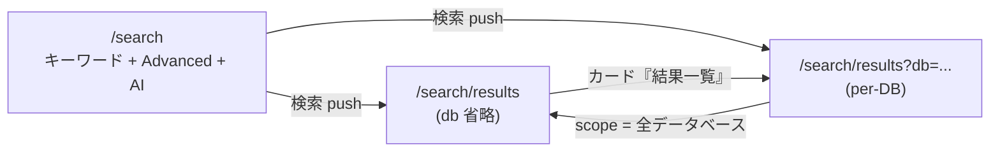
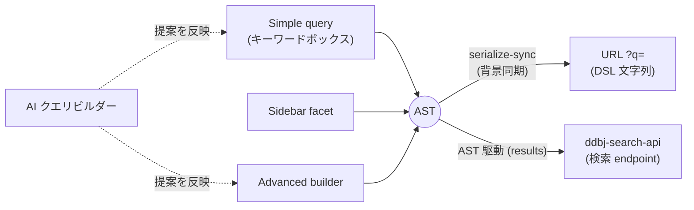
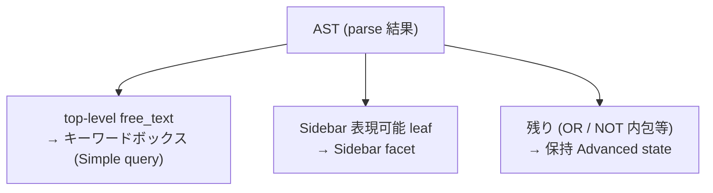
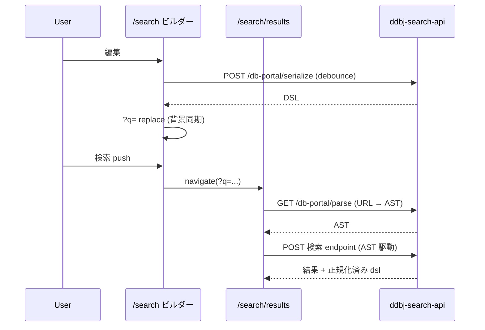

# Search

検索 UI の設計。利用者の検索条件は AST (Abstract Syntax Tree) に集まる。3 つの入力経路が AST を組み立て、client が AST を URL と ddbj-search-api に出力する。cross-DB と per-DB の 2 モード、AI クエリビルダー、INSDC status による公開状態の見え方も扱う。

## 検索の 2 モード

検索 UI は、集計を見るか一覧を見るかで 2 モードに分かれる。cross-DB は、全 DB を横断したヒット件数と上位の hit を表示する。per-DB は、1 つの DB に絞ってレコード一覧と詳細な facet を表示する。利用者はビルダー `/search` で条件を組む。結果ページ `/search/results` の URL に `db` パラメタがあれば per-DB、無ければ cross-DB になる。

DDBJ の DB は内部的に ES (Elasticsearch) backend と Solr backend の 2 系統に分かれる。cross-DB は 2 系統の差を利用者に見せず、per-DB は元の backend に直接問い合わせる。2 系統の差は、Sidebar facet にどの行を出すかと、共通 field の Tier 区分に影響する。

条件を組むビルダーは `/search` だけに置く。`/search/results` の右ペインには Sidebar facet だけを置き、Advanced builder は置かない。DB の選択肢、per-page の値、sort key は `app/lib/search-scope.ts` を SSOT とする。

## AST と入出力経路

検索条件の中心は AST で、BSI の client がメモリ上に持つ正規形である。3 経路 (Simple query / Sidebar facet / Advanced builder) がそれぞれ AST の一部を組み、client が `mergeAstAnd` で AND 結合して 1 つの AST にまとめる。client はまとめた AST を、URL の `?q=` と ddbj-search-api の検索 endpoint の 2 箇所に出力する。`/search/results` の操作中は client が持つ AST が正で、client は URL をバックグラウンドで AST に追従させる (§ URL state)。

AST は client が組む木構造で、検索エンジンに渡せる構造を持つ。DSL は ddbj-search-api が文字列の grammar として規定する serialize 形式で、URL の `?q=` に入る。AST と DSL の相互変換は、ddbj-search-api の `/db-portal/{parse,serialize}` だけで行う。BSI は独自の serializer を持たず、grammar の SSOT は ddbj-search-api 側にある。

AI クエリビルダーは既存の 3 経路に提案を反映する仕組みである (§ AI クエリビルダー)。

## 3 つの入力経路

3 経路は表現できる条件の粒度が違う。Simple query は自由文で入力し、Sidebar facet は候補から選んで絞り込み、Advanced builder はネストした論理式を組む。

### Simple query

検索語の結合は入力の区切り文字で決まる。BSI は `keywordOperator` を送らず、API の default (`OR`) に従う。

- スペース区切り (`cancer mouse`) は AND になる。DSL の文法が値の中の空白を AND で連結するためである
- カンマ区切り (`cancer,mouse`) は OR になる (`keywordOperator` の default)
- クオート (`"Homo sapiens"`) は語順を保った phrase 一致になる
- 末尾のクオート無しの語は前方一致でも一致する (`Huma` で `Human` が一致する)。API の `compile_free_text` が末尾のトークンを phrase_prefix に展開するためである。クオートで囲んだ語には適用しない

キーワードボックスは自由文の入力欄として案内する。ddbj-search-api の文法は `field:value` (allowlist 制) も解釈するが、BSI は画面で案内しない。不明な field や解釈できない構文は parse が 400 を返すので、UI はキーワードボックスを invalid 表示にして知らせる。

free_text が照合する default の field 集合は、ddbj-search-api `compile_free_text` の `_FREE_TEXT_DEFAULT_FIELDS` を SSOT とする。「すべての項目」ではないため、UI は「おもな項目を全文検索」と表示し、ⓘ で field 名を示す。BSI は `keywordFields` に相当する絞り込みを送らない。

### Sidebar facet

`/search/results` の右ペインにあり、結果ページで現在の mode 内の条件を編集できる唯一の UI である。候補値と count は ddbj-search-api の facet 集計から取得し、利用者が選んだ値は filter として AND で結合する。どの mode でどの行を出し、どの DSL field を出力するかは `app/features/search/field-registry.ts` を SSOT とし、Advanced builder も同じ registry を使う。

OR / NOT を持てる条件は Sidebar に置かず、Advanced builder で扱う。`identifier` (accession。各 DB の主キーで、BioProject `PRJDB...` / BioSample `SAMD...` / SRA `DRA/DRP/DRR...` / GEA `E-GEAD-...` 等) の行は Sidebar にも Advanced builder にも出さない。完全一致では絞り込みにならないので、accession はキーワードボックスの free_text と、§ 公開状態と検索可視性 の完全一致の検出で扱う。

field は、いくつの DB が持つかで Tier 1 / 2 / 3 の 3 段階に分かれる。

- Tier 1: 全 DB が共通で持つ field (organism / 識別子 / 日付 等)。cross と全 per-DB で使える
- Tier 2: ES backend の複数 DB が共通で持つ field (`accessibility` / `description` 等)。cross と該当する per-DB で使える。Tier 1 と Tier 2 を合わせたものが、cross で使える全 field である
- Tier 3: 1 つの DB だけが持つ field (BioProject の `project_type`、SRA の `library_strategy`、JGA の `dataset_type` 等)。cross では使えず、該当する per-DB だけで提供する

cross-DB で Tier 3 の条件を送ると API が `field-not-available-in-cross-db` で 400 を返すので、UI は cross-DB に Tier 3 の行を出さない。Solr backend は facet を集計しないので、ddbj / taxonomy 等の Solr の DB では submitter / organism の facet 行も出さない (出しても 0 件になる)。行の並びは意味の順 (subject → 識別 / 内容 → 分類 → access / provenance → 数値 → 日付) にし、表示の種類だけを理由に facet の行を上に移さない。

各行は値域に応じて facet / text / range の 3 種類の制御のいずれかで表示する。distinct な値が少なく列挙できる field は facet (候補のチェックリストと count)、多すぎて列挙できない自由文の field は text (部分一致の入力欄)、数値と日付の連続値は range (FROM-TO) にする。種別は distinct 件数の実測で決め、静的な閾値を docs に書かない。

候補値と count の母集団は self-exclusion を原則とする。facet `F` の bucket は、`q` から `F` 自身のフィルタだけを除いた集合から算出し、hits 本体には `q` の全フィルタを適用する。accession 完全一致で suppressed が解禁されるときは、母集団も hits と同じ `status_mode` で集計する。`organism` の bucket は taxID で集計し、学名のラベルで表示し、選ぶと `organism_id:<taxID>` を条件に加える。集計の外向き契約 (`facets` / `facetsSize` / `facetSelfExclude` パラメタ、response の形、facet 名から DSL field への対応) は ddbj-search-api の `docs/db-portal-api-spec.md § facet 集計` を SSOT とする。

date 行はプリセットボタンと FROM/TO の date input を持つ。プリセットの集合 (`all` と年単位の差分) と URL round-trip 用の値は `app/features/search/sidebar/date-preset.ts` を SSOT とする。

- プリセットは絶対日付を state に持たず、出力時と表示時に現在日から都度算出する
- FROM/TO を手で編集すると `custom` になり、プリセットの選択表示は外れる
- URL は絶対日付の between しか持たないので、復元時に preset 由来の年差分と照合してプリセットの選択を復元する

同一 DB の index の中には、互いに doc を共有しない部分集合 (subtype plane) がある。SRA は experiment / study / sample / run / analysis、JGA は dataset / study / sample 等に分かれ、1 doc は 1 plane に属する。異なる plane の Tier 3 field を AND すると、DSL の parse は通っても hit は 0 件になる。UI は plane 間の排他制御を持たず、行の補足文言で plane の存在を示す。

### Advanced builder

`/search` のビルダーで、ネストした group / condition の tree を組む UI である。field の候補は mode に応じて `field-registry.ts` から決め、演算子の候補は field type から `app/features/search/advanced/field-catalog.ts` が決める (Sidebar と共通)。

- group / root の結合は `innerCombinator` を 1 つだけ選ぶ (Airtable / Notion と同じ方式)。AND / OR の混在はネストで表現する
- UI は group / root ごとに AND / OR のセグメントトグルを 1 つ出し、行間に連結語 (「かつ」 / 「または」) を出さない
- 否定 (NOT) は演算子に統合する。ドロップダウンに `を含む` / `を含まない` のペアを並べ、否定を選ぶと AST 上は condition を NOT で包む。独立した「除外」トグルは持たない
- 先頭行を含む全 condition を独立に否定できる
- `FreeText` は Advanced builder に載せず、Simple query で扱う
- Advanced builder で表現できない構造 (OR / NOT の中の free_text 等) は `toAdvanced` が builder から除き、保持 state として残す

AST と AdvancedState の相互変換 (`toAdvanced` / `fromAdvanced`) は、canonicalize を含めて PBT (property-based testing) で検証する。canonicalize の規則は `app/features/search/advanced/canonicalize.ts` を SSOT とする。

- `toAdvanced(fromAdvanced(s))` は `canonicalize(s)` に等しい
- `fromAdvanced(toAdvanced(ast))` は `canonicalize(ast)` に等しい

state 遷移 (追加 / 削除 / 内部結合切替 / 否定切替 / field・op・value・range 更新 / URL 復元時の root 置換 / 全消去) は `app/features/search/advanced/reducer.ts` を SSOT とする。PBT で検証する性質は次の 2 つである。

- 同じ id を持つ node が木に 2 つ同時に存在しない
- root 以外の任意の node を削除した結果が valid な AdvancedState である

## AI クエリビルダー

自然言語の入力から、新規の条件、または既存の条件に融合した条件を提案する機能 (コード名は `assistant`、BFF の endpoint は `/api/llm/search-assistant`)。4 つ目の入力経路ではなく、既存の 3 経路に提案を反映する。提案はフルスペックの DSL を表す ParseNode (AST の型名) で、client は適用時に free_text を Simple query に、構造化条件を Advanced builder に分解して反映する。server 側の SSE 実装と prompt の設計は [llm.md](llm.md) を参照する。

### LLM の可用性

client は `/api/llm/health` を `useQuery` で取得し、`status` から `ready` を決める (`app/features/search/assistant/llm-availability.ts`)。AI クエリビルダーの入力欄は top page、cross-DB results、per-DB results、`/search` のキーワードボックスに置く。

- `ok` と `unreachable` のときは `ready=true` にし、submit を有効にする。`unreachable` の失敗は、送信時に SSE の error 経路で伝える
- `unset` のときだけ `ready=false` にし、UI を表示しない
- dev server では client は health を参照せず、常に `ready=true` にする (stub の提案で flow を確認するため)

### 呼び出し元ごとの反映先

呼び出し元のページによって、提案カードを介すか直接 navigate するかが分かれる。

| 呼び出し元 | 反映先 | 生成モード |
|---|---|---|
| `/search` ビルダー | 提案カードを read-only で表示する。適用すると AST を分解し、free_text をキーワードボックスに、構造化条件を builder に反映する | new / append |
| cross-DB / per-DB results | 提案カードを出さず、`done` の AST を serialize して `/search/results` に navigate する | new / append |
| top page | 同上 | new 固定 |

### db 引数の auto と locked

生成に使う db は呼び出し元で決まる。server は SSE の `done` で `{ ast, db }` を返し、client はその db に従って遷移する。

- top page / `/search` ビルダー / cross-DB results は auto である。client は db を送らず、BSI の server が生成した DSL の Tier 3 field から db を決める
- per-DB results は locked である。client は現在の `db` を送り、生成はその DB 内で完結する。モデルがその DB に無い Tier 3 field を出したときは parse が `invalid_dsl` を返し、別の DB には遷移しない

### 生成モードの new と append

`/search` ビルダーでは、利用者が生成前に新規生成 (new) か既存に追加 (append) かを選ぶ。モードで prompt が変わるためである。default はビルダーの条件数 (キーワード行の 0 か 1 と、構造化条件の数の合計) で決まり、1 以上なら append、0 なら new になる。

- append: 現在のビルダーの DSL を `current` として送る。モデルは既存の条件を保持したまま融合した完全な DSL を返す。返る AST が既存の条件を含むので、client 側で結合する必要は無い
- new: `current` を送らず、提案だけの新規クエリにする。キーワードも初期化する

## URL state

URL は検索状態の共有と復元の形式である。client は AST から URL へ serialize-sync (バックグラウンドの同期) で書き、URL から AST へ parse (cold load 時の復元) で読む。任意の URL から client の state を復元できるので、共有、ブックマーク、リロード、戻る / 進むが成立する。`/search/results` の操作中は client が持つ AST が正で、client は検索 response に含まれる正規化済みの dsl で URL の `?q=` を更新する。

URL の param は `q` (DSL 文字列、URI encoded)、`db` (省略で cross、値ありで per-DB)、`page`、`perPage`、`sort` である。値域と default は `app/lib/search-url.ts` / `search-scope.ts` を参照する。`q` が無いときは match_all で、cross / per-DB とも `q` を省いて検索 API を呼ぶ。

URL の書き換え方は、編集が画面遷移を伴うかどうかで決まる。

- facet / Advanced / paging の変更は `replace` にし、履歴を増やさない
- 検索ボタン / Enter / クリアは `push` にし、戻る / 進むで状態を移動できるようにする
- per-DB から cross への mode 変更は、`?db=` を削除した別の route への遷移にする

### URL からの復元

`/search/results` の loader は `?q=` を `GET /db-portal/parse` で AST にする。route component はその AST を 3 つの入力先 (キーワードボックス / Sidebar facet / 保持 Advanced state) に分解して state を再構築する。入力時に 3 経路の条件が AST に集まる流れの逆方向である。

`/search` ビルダーも `?q=` 付きで開くと同じ parse と分解を行う。Sidebar / Advanced builder で表現できない構造は保持 state に残す。`q` が空のときは parse を行わず、ast=null のまま 3 つとも初期状態にする。

### parse の失敗

利用者が直せる失敗 (キーワードの構文エラー) と、system 側の失敗 (serialize / 同期の失敗) を区別する。retry の方針は `app/lib/query/client.ts` にあり、query は再試行し、debounced serialize の mutation は再試行しない。

- `/search` でキーワードの parse に失敗したとき: UI はキーワードボックスを invalid 表示にし、プレビューの位置に warn の `<Callout>` を出し (プレビューと排他)、「この条件で検索」button を disable にする。results に遷移させず、その場で直せるようにする
- `/search/results` で URL の `?q=` の parse に失敗したとき: loader が `parseError` を返し、route component が warn の `<Callout>` を出す。「再試行」は `navigate(0)` を実行する。throw / ErrorBoundary の経路は通らない。検索 API の 5xx や network error は loader が `systemError` として返し、route component は同じ `<Callout>` で示す
- system 側の serialize / 同期の失敗: 警告も disable も行わず、sync chip だけで状態を示す。表示中の検索結果は古いまま使える

### sync chip

`SyncStatus` chip は `/search` だけに出す (状態の種別は `app/features/search/sync-status.tsx`)。chip は状態を示すだけで操作を持たない。再試行の操作は、parse エラーのときにクエリプレビュー上に出す warn の `<Callout>` にだけ置く。system 側の同期失敗は chip で示し、次の編集で再同期する。`/search/results` は AST から直接検索し、serialize endpoint を使う serialize-sync を持たないので chip を出さない。

## API との往復

AST / DSL の grammar は ddbj-search-api 側 (`/db-portal/{parse,serialize}` の仕様) を SSOT とする。BSI は AST を 3 経路で組み立て、merge して送るだけである。`/search` ビルダーは AST から DSL への serialize をバックグラウンドで同期し、`/search/results` は AST で検索する。URL の `?q=` は、GET で直接開いたとき (cold load) の復元に使う。

- `serialize` / `parse` / AST での検索は、現在の `db` mode を付けて呼ぶ (per-DB は当該 DB、cross は省略)。Tier 3 field を含む AST を mode 無しで送ると `field-not-available-in-cross-db` で 400 になるためである
- `/search` の serialize sync は 1 つの debounce で `parse → merge → serialize` を行い、単調増加するトークンで古い応答を捨てる。request はキャンセルしない
- 同期に失敗したときは URL を書き換えない。表示中の結果は古い URL のまま使える

### mergeAstAnd

3 経路の AST を AND で結合する純粋関数 `mergeAstAnd` と、空の AST `identityAst` は `app/features/search/ast/` を SSOT とする。結合律、単位元、平坦化を PBT で検証する。

- 結合律: `merge(merge(a, b), c) ≡ merge(a, merge(b, c))` (canonicalize 後)
- 単位元: `merge(a, identityAst) ≡ a`
- 空消滅: `merge() ≡ identityAst`
- 保存性: 結果の rule 集合は入力の rule 集合の和 (重複あり) に等しい
- 平坦化: 結果が `BoolOp(AND, [...])` のとき、子に `BoolOp(AND, ...)` は現れない
- 冪等ではない: 同じ node を 2 回渡すと重複した child ができる。等価判定は構造比較 (`astEquals`) で行う

## 公開状態と検索可視性

レコードの公開状態 (INSDC status) で検索可視性が変わる。status の enum 値域と判定は ddbj-search-api 側 (`db-portal-api-spec.md § データ可視性`) を SSOT とする。BSI は検索条件を送るだけで、解禁の判定や status のフィルタを持たない。

- 通常検索 (キーワード / facet) では `public` だけがヒットする
- 検索条件が accession の完全一致 (top-level が単一 accession の free_text / identifier であるか、top-level の AND の直下にそれを持つ) のとき、backend が `suppressed` を解禁する。OR / NOT の配下やワイルドカードでは解禁しない
- BSI が表示で区別するのは `suppressed` だけである (Suppressed バッジ)。cross-DB の結果では、client が AST の top-level の形を見て完全一致かどうかを表示のためだけに判定する
