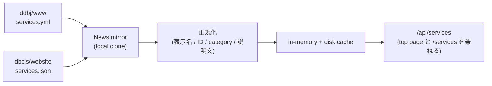

# Services

services は、News mirror が clone した local repo を read-only で参照し、`/api/services` の 1 endpoint で top page のセクションと `/services` 一覧の両方のデータを返す。2 source の正規化、cache、`featuredTop`、facet を扱う。

## services の役割

services は独自の git clone もポーリングも持たず、News mirror が維持する local clone を read-only で参照する。News mirror が source の HEAD の変化を services に通知する。services は source ごとに正規化して in-memory と disk の両方の cache に保存し、`/api/services` の 1 endpoint で top page のセクション (`featuredTop === true` のみ) と `/services` 一覧 (全件と facet) の両方を返す。BFF が外部 API との接続と secret を扱う一般則は [architecture.md](architecture.md) を参照する。

source ごとの実ファイルと抽出条件は `server/services/sources.ts`、正規化の方法は `server/services/normalize.ts` を参照する。

## 入力 source と cache

clone / pull は News mirror が行う。services は HEAD の変化通知を受けたとき、その source の分だけを再構築する。2 source (DDBJ `services.yml` / DBCLS `services.json`) の責務は重ねず、services が重複する entry を filter で除いて disjoint に保つ。

- services は独自のポーリング間隔を持たず、News mirror が出す sha の変化通知を起点にする
- services は `ddbj-www/services.yml` から DBCLS が提供する entry を除外し、source 間の disjoint 性を保つ

### cache

2 段 cache (in-memory と disk)、起動時の disk cache の即時 load、`schemaVersion` 不一致時の空 cache への fallback、source 単位の atomic な差し替えといった共通の規約は [entity-list.md § 2 段 cache](entity-list.md) に従う。services に固有の差分は次の 3 点である。

- 再構築の起点は独自の poller ではなく、News mirror の sha 変化通知である。受け取った sha と `lastSyncSha[source]` が一致するときは、services は何もしない
- atomic に差し替える単位は source (DDBJ / DBCLS) の 2 系統である。一方の source の再構築中に、他方の source の items は変更しない
- ファイルの read や normalize に失敗したときは、services は warn を log に出すだけにし、既存の items を維持する

cache の配置先、`schemaVersion` を上げる規約、差し替えの手順は `server/services/cache.ts` と `server/services/mirror.ts` を SSOT とする。

## 正規化

各 source の生の entry は語彙が違ったり表記が揺れたりするので、services は同じ shape に揃えてから cache に入れる。処理は、表示名の override、ID の採番、category の写像、説明文の順に行い、後の処理は前の処理の結果を使う。ID は override 後の名前から作り、category は source ごとに別々に写像する。

### 表示名 override

upstream の英名には、冗長なものや和名が混じるものがあるので、BSI 側で override 表を持って表示名を揃える。`id` の生成と `featuredTop` の判定も override 後の名前で行い、表示と判定が同じ名前を使うようにする。override 表は `server/services/sources.ts` を SSOT とする。

### ID 採番

`id` は override 後の英名から機械的に生成する slug で、source の prefix を伴う。生成式と URL-safe の制約は `server/services/normalize.ts` を SSOT とし、upstream の表記揺れに対して `id` が安定していることは PBT (property-based testing) で検証する。

### category 写像

services は各 source の元の語彙を BSI 共通の `ServiceCategory` (機能による分類) に写像し、結果を複数値の `categories` として持つ。写像に無い語彙は、UI を壊さないように `other` にする。

- `categories` は重複を除いた `ServiceCategory[]` で、空のときは `["other"]` になる
- 写像前の元の語彙は `rawCategories` に保持し、デバッグに使えるようにする
- domain の軸 (Genome / Gene / Gene expression / Disease 等) は、機能の軸である `ServiceCategory` の判定に使わない
- `ServiceCategory` の enum と response の Zod schema は `app/schemas/api-bff/service.ts` を SSOT とする
- source 別の mapping (`DDBJ_TAG_MAP` / `DBCLS_CATEGORY_MAP` / `DBCLS_CATEGORY_OVERRIDES`) と domain の軸の判定は `server/services/normalize.ts` を SSOT とする

### 説明文

upstream の `description` は末尾の句点の有無が混在している。cache と API の生データは upstream のまま保持し、表示時に言語別の句点 (ja は `。`、en は `.`) を補って統一する。補完は表示用の helper (`app/lib/api/services.ts`) だけで行い、storage 層では行わない。

## /api/services

`/api/services` は 1 つの endpoint で 2 つの用途を兼ねる。route は SSR loader を持たず、client が TanStack Query で 1 回 fetch し、top page と `/services` で同じ query key を共有する。用途の使い分けは client 側で `featuredTop` フラグの絞り込みや facet の選択で行い、用途ごとの endpoint を増やさない。

### top page

top page の services セクションは、`/api/services` を全件取得して client 側で `featuredTop === true` の item だけを表示する。`/services` と query key を共有するためである。判定の規約は source ごとに異なる (DDBJ は name の whitelist、DBCLS は name の prefix) が、client から見れば boolean フラグ 1 つで扱える。whitelist と prefix は `server/services/sources.ts` を SSOT とする。

### /services 一覧と Facet

`/services` 画面の facet sidebar は、`category` (`categories` の値、enum) と `source` (ddbj / dbcls、enum) の 2 グループで構成する。選択肢の値域は cache に実際に出現する値だけにし、サイト全体の enum を全部出して 0 件の選択肢を並べない。

- グループ間の AND、グループ内の OR、facet count の self-exclusion、URL の serialize の規約は [entity-list.md § URL state と件数](entity-list.md) に従う
- source の色点と AppliedFilters の chip の表示は [entity-list.md § source 軸](entity-list.md) に従う
- 一覧は name のアルファベット順に並べ、Toolbar で昇順 / 降順を切り替えられる
- item は日付の軸を持たないので、year facet と date sort は出さない

### HTTP 契約

| query | 動作 |
|---|---|
| `source` | comma separated。いずれかの source に一致する item を返す |
| `category` | comma separated の `ServiceCategory`。`categories` がいずれかを含む item を返す (OR) |
| `featured` | truthy (`true` または `1`) のとき、`featuredTop === true` の item だけを返す。BSI の client は使わない |

- endpoint は全 query を AND で適用する
- endpoint は response に `Cache-Control` を付ける (値は `server/api/services.ts` を SSOT とする)
- response の形は `app/schemas/api-bff/service.ts` の Zod schema を SSOT とする

## 環境変数

env の定義 / 型 / default は `server/lib/env.ts` の Zod schema が SSOT で、値は `env.staging` 等が SSOT である。この文書に関わる env:

- `DB_PORTAL_SERVICES_CACHE_DIR`: disk cache のディレクトリ
- repo の clone 先、branch、ポーリング間隔は News mirror が管理するので、services は `DB_PORTAL_NEWS_*` をそのまま使う ([news.md](news.md))
