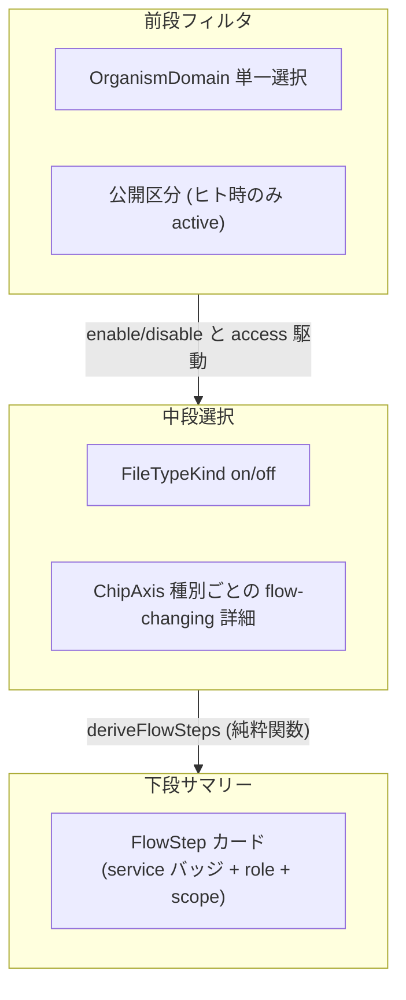
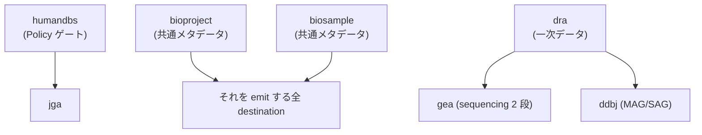
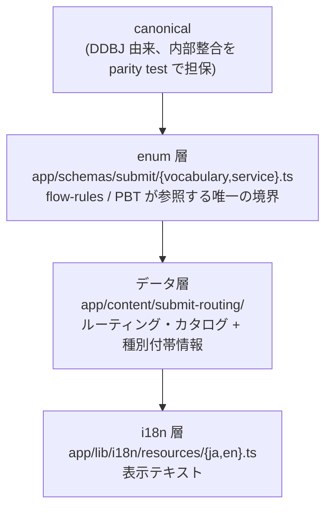
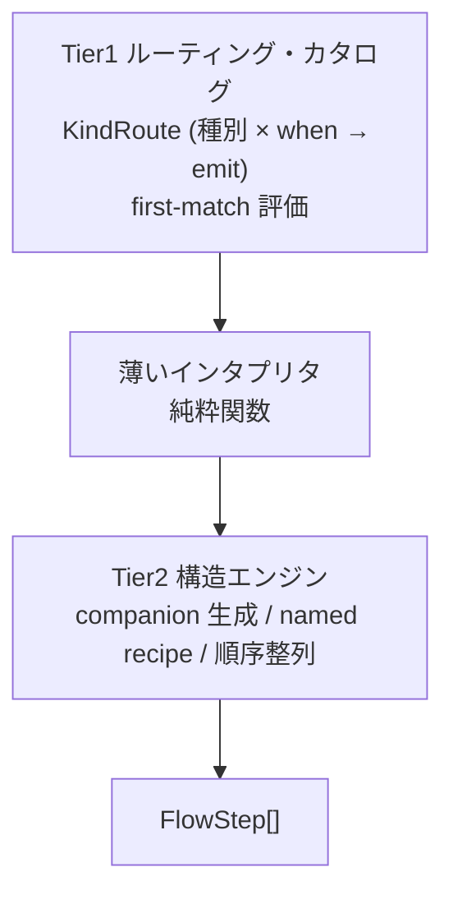

# Submit

submit features は navigator として、利用者がデータの性質を答えた結果から「どの service に何を登録するか」を導出する。入力の 4 軸、ヒトのときの公開区分、出力の FlowStep カードと service の役割と Step 依存、経路導出の Tier1 カタログと Tier2 エンジンを扱う。

この文書の「service」は、submit の destination / companion / external の役割を持つ enum (`app/schemas/submit/service.ts`) を指す。同じ語で呼ぶ別の概念が 2 つある。

- 内部の Service tile と詳細ページ: `app/content/services/*.content.tsx` ([content.md](content.md) § TS collection)
- 外部の DDBJ / DBCLS サービスの mirror: `server/services/*` ([services.md](services.md))

## navigator の役割

navigator は、利用者が手元のデータの性質を 4 軸 (§ 入力 4 軸と AccessSection) で答えた結果から、「どの service に何を登録するか」を導出する。各 service の細目 (BioSample の生物種や package、DRA の Library Strategy のような Intra-DB Tag) は扱わず、各 service の登録ウィザードで入力する。navigator は全体の俯瞰と、詳細ページへのリンクだけを提供する。

UI は、前段フィルタ、中段選択、下段サマリーの 3 段で構成する。下段サマリーは中段の選択から純粋関数で導出し、利用者は下段を直接編集しない。サマリーは FlowStep カードの並びで、各カードは `{ service, role, scope }` を持つ。1 枚のカードは、どの service に対して、どの役割 (§ destination / companion / external の 3 役割) で、submission のどの部分集合 (groupIds / entryIds) を登録するかを示す。

導出は `deriveFlowSteps(submission)` の 1 関数に集約する。この関数は副作用を持たず、入力の `Submission` を変更しない。実装は `app/features/submit/flow-rules/derive-flow-steps.ts` で、中身 (Tier1 カタログと Tier2 エンジン) は § 経路導出 で扱う。

## 入力 4 軸と AccessSection

submission は 4 軸で表現する。各軸は flow-changing な意味 (答えが destination の集合、必須 step、scope のまとめ方を変えるもの) だけを担い、4 軸で表現できない細部は Intra-DB Tag で扱う。値域と enum は `app/schemas/submit/vocabulary.ts` / `service.ts` を参照する。

- OrganismDomain: submission 全体に対して単一選択する生物の軸。種・属レベルの分類は持たず、BioSample の Intra-DB Tag で扱う。`human` を選んだときだけ、公開区分のセクションが active になり、JGA への分岐が起こりうる
- FileTypeKind: 一次データとして登録する単位だけを値域とする、中段のトグルの単位。付随するメタデータ (表現型・サンプル属性) は BioSample の Intra-DB Tag で扱い、付随するファイル (processed 画像・可視化オブジェクト) は主データの step の追加ファイル枠で扱う。どちらも `FileTypeKind` には含めない
- Access: `open` / `restricted` の 2 値で、file ごとの混在は持たず、種別単位で決める。`restricted` かつ `OrganismDomain = human` の組み合わせだけが JGA への分岐の起点である。非ヒトの非公開は、INSDC が制限公開の仕組みを持たないので、DRA に embargo (公開予定日) を付けて扱う
- ChipAxis: 前段で表現できず、かつ flow-changing な細部だけを種別ごとに持つ。登録先の service を変えない区分は ChipAxis にせず、Step カードの Intra-DB Tag で扱う。軸ごとに単一値か複数値かを宣言する

flow-changing な軸だけを 4 軸にすることで、答えても経路に反映されない質問と、経路を変える要因が pulldown の中に隠れる事故の両方を防ぐ。

ChipAxis が同一 entry にいくつの値を持てるかは、軸の宣言に従う。値どうしが排他な軸は単一値で、1 entry に 1 値だけを持つ。併用が成り立つ軸だけを複数値にし、同一 entry に複数の値を同時に持つ。複数値の軸は詳細フォームでも複数選択の control で表示し、単一値の軸と同じく 1 つ以上の選択を必須にする。どの軸が複数値かは `app/schemas/submit/vocabulary.ts` を SSOT とする。

### AccessSection

公開区分は、`AccessSection` の入力から種別ごとに純粋関数で導出する。ヒトのときだけ active で、非ヒトの OrganismDomain では全種別が `open` になる。優先度と if/else の順序は `app/features/submit/access.ts` の `deriveAccess` を、種別ごとの既定値は `vocabulary.ts` の `IDENTIFIABLE_KINDS` を SSOT とする。

UI の構成 (上部のトグル 2 つ、サブトグル 3 つ、種別ごとの ChipAxis):

| 位置 | control | 役割 |
|---|---|---|
| 上部 | トグル × 2 | 「制限公開を希望する」(主観的な希望) と「個人識別符号を含む」(法令上の該否)。どちらも ON にすると全種別が restricted になる |
| サブ | トグル × 3 | 「倫理指針に沿ったヒト研究」「一般入手可能な試料の解析」「微生物自体の分析 (ヒト配列除去済み)」 |
| 種別ごと | ChipAxis | 種別ごとの反転 (`identifiability`)。`Yes` にすると当該種別だけ open、`No` にすると当該種別だけ restricted になる |

各 control の TS 識別子と既定値は `app/schemas/submit/submission.ts` (`AccessSection`) を参照する。

導出の規約:

- 「制限公開を希望する」と `hasIdentifier = Yes` は強い意思表示として扱い、サブ条件 3 つ (倫理指針 / 一般入手 / 微生物) を disable にする
- サブ条件 3 つは意味的に排他なので、UI で同時に ON にできないようにする
- 種別ごとに導出するので、同一 submission 内で `restricted` と `open` が混在してよい
- `restrictedPreference` と `hasIdentifier` はどちらも全種別を restricted にするが、主観的な希望と客観的な事実 (法令上の該否) という別の軸なので、別の control として並べる

### 指針対象 (humandbs 申請) 判定

ヒトで指針の対象になるデータは、NBDC ヒトデータベースへの提供申請 (humandbs) を必要とする。この判定は `Access` (`open` / `restricted`) とは独立に行う。判定は `app/features/submit/access.ts` の `requiresHumandbsApplication` を SSOT とする:

`requiresHumandbsApplication = (organismDomain === "human") ∧ (restrictedPreference ∨ hasIdentifier ∨ ethicsCompliance)`

- `publiclyAvailable` と `microbialAnalysis` は「指針対象外」として扱う。`restrictedPreference`、`hasIdentifier`、`ethicsCompliance` がすべて false なら humandbs 申請は不要である
- 判定が true の submission では、destination (JGA / DRA / GEA / DDBJ / MetaboBank / NSSS) とは独立に `humandbs` step が 1 枚出る
- 非制限公開 (`open`) でも humandbs 申請が必要な組み合わせは正当な状態である。「open なら申請不要」とは限らない
- サマリーでは `humandbs` のカードを、制限公開・非制限公開のどちらのグループにも入れず、提供申請のグループに置く。提供申請は公開区分に関係なく登録前に必要であり、制限公開のグループに置くと非制限公開のデータには不要に見えるためである
- `humandbs` のカードがあるサマリーでは、制限公開・非制限公開の両方のグループに「提供申請の承認後に登録する」と表示し、「直接登録」とは案内しない

## 出力 FlowStep カード

下段サマリーは `FlowStep[]` を Step 依存グラフのトポロジカル順に並べたものである。各 FlowStep の `service` enum 値、`role` の割当、accession の形式、slug の解決は `app/schemas/submit/service.ts` を、外部 URL は `app/content/services/*.content.tsx` を SSOT とする。

### destination / companion / external の 3 役割

`Service` は単一の enum で、各値が role を 1 つ持つ。

- destination: 利用者のデータの最終的な格納先。Tier1 の `emit.service` に現れる (§ 経路導出)
- companion: submission 全体に共通する導出物 (BioProject / BioSample / Umbrella BioProject)。Tier2 が submission 全体から生成する (§ 経路導出)
- external: DDBJ 外の登録窓口への誘導。登録エンドポイント (jpost / eva) と、登録前に必要な申請 (humandbs) がある

### DDBJ サービス一覧

`Service` enum の全要素、role の割当、accession の形式、slug の一覧は `app/schemas/submit/service.ts` を SSOT とする。この文書には 3 つの role が担う概念だけを書き、slug の一覧は書かない。一覧を docs にも書くと、service を追加したときに docs と code がずれるためである。

| role | 担うもの |
|---|---|
| companion | BioProject / BioSample を前提とする destination に 1 組添付する共通メタデータ |
| destination | データを最終的に受け入れる DDBJ の登録 service (DRA / JGA / DDBJ / GEA / MetaboBank / NSSS 等) |
| external | DDBJ 外部の登録窓口と Policy の申請 (NBDC humandbs / jPOST / EVA 等) |

サマリーカードのバッジの色は、role と、notes に warning / error があるかどうかから、純粋関数 `serviceBadgeColor` で決める。色の値は `app/styles/tailwind.css` の `@theme` トークンを SSOT とする。「詳細を見る」link は、内部の詳細ページ (`/<slug>` の catch-all route) を持つ service にだけ出す。判定は `service.ts` の `internalDetailHref` / `hasInternalDetailPage` を SSOT とする。

### Step 依存とカード順序

service 間の前提関係を Step 依存グラフとして宣言し、カードの順序と「先に済ませること」ブロックの両方をこのグラフから決める。辺の集合は `service.ts` の `SERVICE_DEPENDENCIES` を、トポロジカル順を実現する線形順は同ファイルの `SERVICE_DEPENDENCY_ORDER` を SSOT とする。

- カードの順序はこの依存グラフのトポロジカル順で、前提の step が依存する step より前に出る
- 線形順は「申請 (humandbs) → 共通メタデータ (bioproject → biosample) → 一次データ (dra) → 主登録先 → 外部リポジトリ (jpost / eva)」である
- 各 step の「先に済ませること」ブロックには、前提の step のうち、そのフローに実在するものだけを表示する
- 同一 service の scope は union して 1 step にまとめる
- `FlowStep.scope` は `groupIds` か `entryIds` の少なくとも一方が非空でなければならない

サマリーはカードをグループに分けて表示し、グループの中ではこのトポロジカル順を保つ。ヒトのサマリーは、共通メタデータ、提供申請 (`humandbs`)、制限公開、非制限公開の 4 グループをこの順に並べる。非ヒトのサマリーは、共通メタデータ、登録先の 2 グループをこの順に並べる。カードの無いグループは表示しない。グループの並びは上の線形順より優先し、共通メタデータのグループを先頭に置く。グループ分けは `app/features/submit/flow-cards/group-flow-steps.ts` の `groupFlowSteps` を SSOT とする。

### アカウント誘導ステップ

未ログインのときは、`FlowStep[]` の外側の案内として「DDBJ アカウントの取得」を促す step 0 を表示する。表示条件は `flow-summary-card` が `SERVICE_ROLE` を参照して決める:

- 表示する: `!isAuthenticated` かつ、`steps` に role が `destination` か `companion` の service が 1 つでもある (DDBJ 管轄の登録先を含む)
- 表示しない: 全 step の role が `external` だけ (`humandbs` / `jpost` / `eva`)。例えば proteome は `jpost` だけ、非ヒトの variant は `eva` だけになる。これらの登録先は DDBJ アカウントを使わないので、誘導を出さない

JGA のフローは humandbs (external) と jga (destination) を含むので、誘導を表示する。

## controlled vocabulary の 4 層

navigator が扱う語彙は、DDBJ 由来の canonical な定義から派生する 4 層で構成する。層の境界は起動時の Zod と parity test で機械的に検証し、codegen は使わない。enum を増減すると意味論が変わるので、enum 層の編集には人間のレビューを必須にする。

- カタログの `note.messageKey` は i18n key の集合と完全に一致しなければならない
- データ層の `when` DSL (§ 経路導出) は、単一の FileEntry / 単一の FileGroup / 前段の属性に対する controlled vocabulary の等値比較だけを書ける。submission 全体の集約、算術、文字列マッチ、動的な emit は書けない。ネストの深さの上限は 3 である
- DSL で表現できない例外は DSL 側で無理に表現せず、Tier2 の named recipe をコードで追加する
- named recipe の集合は allowlist (`RECIPE_ALLOWLIST`) で固定し、allowlist の外には増やさない
- i18n は ja / en の parity を PBT で検証し、揃わない文言は表示しない
- INSDC 共通の vocabulary (DRA `Library Strategy` 等) の更新は、enum 値の差し替えで対応する

## 経路導出

経路導出は 2 層に分ける。Tier1 は DDBJ が編集できるルーティング・カタログで、種別ごとに「この `when` 条件のとき、この service を emit する」という rule を first-match で並べる。Tier2 はコードと PBT で固定する構造エンジンで、companion の生成、named recipe、順序の整列を行う。単一の種別の選択だけで宛先が決まる軸は Tier1 に、submission 全体の集約や 1 種別から複数 archive への登録を要する軸は Tier2 の named recipe に置く。実装は `app/features/submit/flow-rules/` 配下にある。

### entry と group

経路導出の入出力で使う Submission の基本単位は、entry (1 種別の 1 ファイルまたはファイルの組) と group (複数 entry のまとまり) である。各 entry は `entryId`、各 group は `groupId` を持ち、`FlowStep.scope` はそのカードが対象とする `groupIds` / `entryIds` を持つ。

### Tier1 のルーティング・カタログ

Tier1 は KindRoute の集合で、1 つの KindRoute は 1 種別の `when` 条件と `emit` 候補を宣言する。

- `KindRoute = { kind, candidateRepos, rules: [{ when, emit }] }`
- `rules` は first-match で評価する。entry が rule の `when` (controlled vocabulary の等値比較の DSL、ネスト 3 まで。§ controlled vocabulary の 4 層) に合致した時点で、その rule の `emit.service` / `emit.scope` / `notes` を返す
- `emit.companion` が `false` の rule に合致した entry は、Tier2 の companion 生成の対象にしない。登録先が BioProject / BioSample を前提とする service でも、その登録では BioProject / BioSample を必須としない場合 (MSS で登録する遺伝子配列) に使う
- `candidateRepos` (種別ごとに宣言する登録エンドポイントの上位集合) は、登録エンドポイント (role が destination の service と、登録エンドポイントとして扱う external の service) の部分集合でなければならない。範囲外を emit するカタログは、起動時の Zod と parity test で失敗する

### Tier2 の構造エンジン

Tier2 は Tier1 の出力を受けて、1 種別では完結しない構造を組み立てる。

- companion 生成: 非 `jga` の entry のうち、emit 先の service が `SERVICE_DEPENDENCIES` で `bioproject` / `biosample` を宣言し、かつ合致した rule が `emit.companion = false` でないものを scope とする `bioproject + biosample` のペアを 1 組だけ足す。該当する entry が 0 なら足さない。外部エンドポイント (`jpost` / `eva`) は DDBJ 内の companion を必要としないので、これらだけを emit するフローでは BioProject / BioSample (以下 BP/BS) の step を生成しない。NSSS (`nsss`) は DDBJ 内の destination だが BioProject / BioSample を記載できないので、BP/BS を前提にしない。NSSS の step には、BioProject / BioSample を登録する場合は MSS (`ddbj`) で登録する旨の warning note を付ける
- named recipe: 1 種別から複数 archive への登録、または submission 全体の集約を要するケースを、名前付きの純粋関数として宣言する。集合 (`humandbsPolicySteps` / `jgaDatasetSteps` / `spatialSteps` / `expressionDraSteps` / `sequenceDraSteps` / `haplotypeSteps`) は `RECIPE_ALLOWLIST` で固定し、allowlist の外には増やさない
  - `humandbsPolicySteps` は、§ 指針対象 (humandbs 申請) 判定 が true の submission に対して、destination に関係なく `humandbs` step を 1 枚 emit する
  - `jgaDatasetSteps` は、Tier1 で `jga` に routing された entry を scope とする `jga` step を 1 枚 emit する。前提の `humandbs` step は `humandbsPolicySteps` が emit する
  - JGA のフローでも humandbs step を emit するのは `humandbsPolicySteps` だけである。humandbs step は 1 枚に集約され、`humandbsPolicySteps` の出力をそのまま採用する
- 順序整列: 同一 service の Step を 1 枚に union し、`SERVICE_DEPENDENCY_ORDER` (§ Step 依存とカード順序) の線形順で並べる

### 合成順序と walk-through

`deriveFlowSteps(submission)` は次の順序で評価する。

1. 前段のカスケード (`isKindEnabled(organismDomain, fileTypeKind)`) で disable された entry を除く
2. Tier1 の `routeEntries` で、残った entry を `KindRoute` の `when` 列に通し、first-match で `(entry, service, scope, notes)` の `EntryRouting[]` を得る
3. `jga` の routing と非 `jga` の routing に分け、非 `jga` は service ごとに 1 枚にまとめる
4. § Tier2 の構造エンジン の条件に従って、companion の `bioproject + biosample` のペアを 1 組足す。該当する entry が 0 なら足さない
5. named recipe を順に適用する。`humandbsPolicySteps` は指針対象の判定に基づいて、active な entry を scope とする humandbs step を 1 枚足す。`jgaDatasetSteps` は jga の entry を scope とする jga step を 1 枚足す
6. 最後に `mergeSameServiceSteps` で同一 service のカードを 1 枚に集約し、`SERVICE_DEPENDENCY_ORDER` の線形順で sort する

walk-through:

- 完成ゲノムを公開: OrganismDomain = `eukaryote`、1 entry が `sequence` (chip = `assembly-form: genome` + `has-annotation: true`)、Access = `open`。Tier1 が `ddbj` (MSS) を emit し、Tier2 の companion で `bioproject + biosample` が付く。結果は `bioproject → biosample → ddbj` の 3 枚になる
- 遺伝子配列を登録: OrganismDomain = `prokaryote`、1 entry が `sequence` (chip = `assembly-form: gene` + `has-annotation: true`)。`small-scale: true` も付くと Tier1 が `nsss` を emit する。`nsss` は BP/BS を前提にしないので、結果は `nsss` の 1 枚になる。`small-scale` が無いと Tier1 が `ddbj` (MSS) を `emit.companion = false` で emit し、結果は `ddbj` の 1 枚になる。`small-scale` は `assembly-form: gene` のときだけ NSSS への分岐に使う。NSSS はゲノム・WGS・TSA・TLS を受け付けないので、`assembly-form: genome` では常に MSS に分岐する
- ヒトのシーケンスリードを制限公開: OrganismDomain = `human`、1 entry が `sequence-read`。`hasIdentifier = Yes` の既定により全 sequence-read が `restricted` になる。access の導出が `restricted ∧ human` を満たすので、Tier1 が `jga` に分岐する。jga の entry は companion のペア生成から除外され、`humandbsPolicySteps` が humandbs (Policy ゲート) を、`jgaDatasetSteps` が jga submission を emit する。結果は `humandbs → jga` の 2 枚になる
- ヒトの空間トランスクリプトームを非制限公開 (指針対象): OrganismDomain = `human`、1 entry が `spatial-transcriptomics`、default の AccessSection (`ethicsCompliance = true`)。種別ごとの default で `open` になる (matrix 系は `IDENTIFIABLE_KINDS` に含まれない) が、`requiresHumandbsApplication` が true なので `humandbsPolicySteps` が humandbs を emit する。Tier1 は `gea` を emit し、Tier2 の companion で `bioproject + biosample` が付く。結果は `humandbs → bioproject → biosample → gea` の 4 枚になる
- プロテオームを公開 (jPOST のみ): OrganismDomain = `eukaryote` (非ヒトの全種、またはヒトで非 restricted かつ指針対象外でも同じ)、1 entry が `proteome`、Access = `open`。Tier1 が `jpost` を emit する。`jpost` は `SERVICE_DEPENDENCIES` で BP/BS を宣言しないので companion 生成の対象外で、指針対象外なので humandbs も出ない。結果は `jpost` の 1 枚だけになる。全 step の role が external なので、UI 側 (`flow-summary-card`) の DDBJ アカウント誘導ステップも表示しない (§ アカウント誘導ステップ)

### PBT で固定する制約

次の性質は `tests/pbt/` で `numRuns=1000` の PBT で検証し、reducer、カタログ、named recipe のどこを書き換えても成り立つことを保証する。

- 決定性: 同じ input に対して、sort も含めて同一の output を返す
- JGA 排他: 任意の種別について、`restricted ∧ OrganismDomain = human` なら JGA の scope に入り、それ以外なら公開系 destination の scope に入る。同じ種別が両方に入らない
- humandbs-when-subject-to-policy: `requiresHumandbsApplication(organismDomain, accessSection)` が true で、active な entry が 1 件以上ある submission では、`humandbs` step が 1 枚出る (JGA のフローかどうかに関係なく)
- humandbs-not-when-out-of-scope: `requiresHumandbsApplication` が false の submission では、`humandbs` step は 0 枚である
- nsss-no-companion: `nsss` の step に入る entry は、`bioproject` / `biosample` の step の scope に入らない
- no-orphan-destination: enable された全種別が、bioproject / biosample 以外の destination service の step に最低 1 つ入る
- conflict-kind-no-step: 前段で disable された種別は step を生成せず、その entryId はどの step の scope にも現れない
- cascade-no-deadend: 任意の OrganismDomain で enable された種別を選ぶと、destination service が 1 枚以上出る
- catalog-vocab-closure: 全 `when` の値が controlled vocabulary のメンバーで、`emit.service` が登録エンドポイントに存在する
- candidateRepos-parity: `KindRoute.candidateRepos` は rules の全 `emit.service` を含み、前段カスケードで enable される集合と一致する

### Validation

`selectValidations(state)` は副作用の無い純粋関数で、サマリーの直前に軸別の検査を行う。各 validation は i18n key と該当する種別を含み、利用者が UI でクリックすると該当箇所に scroll する。

- precondition-conflict: 前段で disable された種別が選ばれたまま残っている。この種別は経路導出から除外されるので、`no-destination-service` と二重に数えず、こちらに集約する
- no-destination-service: その種別がどの destination service の step にも入らない
- dangling-group-id: group の参照先が存在しない (UI のバグの検知用)

## URL state

navigator の状態は URL の search params に同期し、リンクの共有、再読み込み、戻る / 進むで再現する。serialize / deserialize と、access flag の TS field と URL value の mapping は `app/lib/submit-url.ts` を SSOT とする。

- URL 上の識別子 (param 名、access flag の値、enum 値) はすべて kebab-case で表現する。TypeScript の schema は camelCase のまま扱い、入出力の境界でだけ mapping する
- DEFAULT 状態の `AccessSection` (倫理指針だけ ON) は URL に書かない。`null` と DEFAULT を外部から見て等価として扱い、再読み込み時に `null` として復元する
- 不明な key / 値は無視する。互換 fallback を持たない
- 任意の `SubmitUrlState` について `readSubmitParams(writeSubmitParams(s))` は s と等価である (上記の `null` / DEFAULT の正規化を除く)。`numRuns=1000` の PBT で検証する

## navigator の境界

submit features は navigator として「どの service に何を登録するか」だけを導出し、ファイルそのものや種別ごとの細目は扱わない。次の振る舞いは navigator に意図して持たせず、各 service の Intra-DB Tag と詳細ページで扱う。

- 外部 API を呼ばない (navigator だけで完結し、SSR loader も持たない)
- 実ファイルを読まないので、ファイル名・拡張子・配列長・Feature 数による判定を持たない。MSS / NSSS の規模の境界は Step の note の文言で案内する
- 種別間の相互排他を持たない。multi-omics の 1 提出は正当で、種別の絞り込みは前段の OrganismDomain のカスケードだけが行う
- 同一種別を多段に分けて段階や属性ごとに扱う高度なケース (MAG の多段チェーン、JGA の Policy 単位の Dataset 分割) は持たず、各ウィザード側の Intra-DB Tag で扱う前提の単一のガイド step で案内する
- 生物の軸は OrganismDomain の単一選択で、種別単位の細かい生物分類を持たない (BioSample の数と生物種は Intra-DB Tag で確定する)
- 詳細なウィザードの手順は各 service の `/databases/$slug` ページで扱い、サマリーカードは全体の俯瞰と詳細へのリンクだけを提供する
